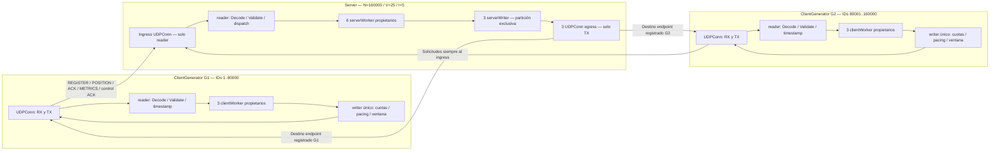
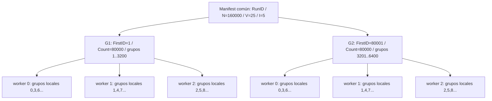
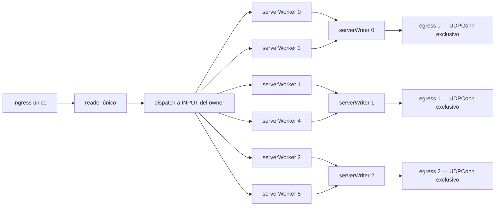
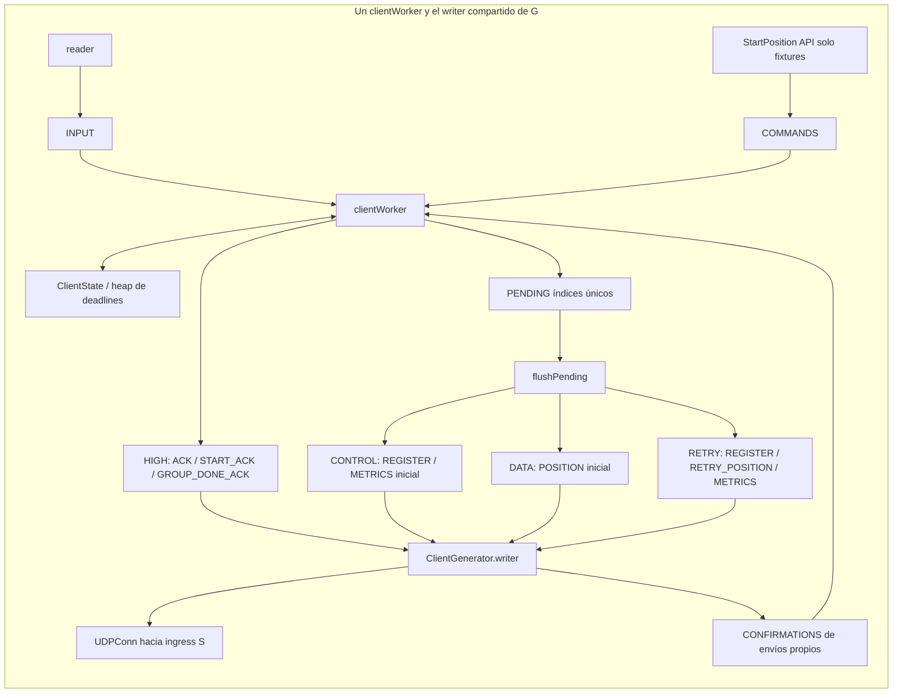
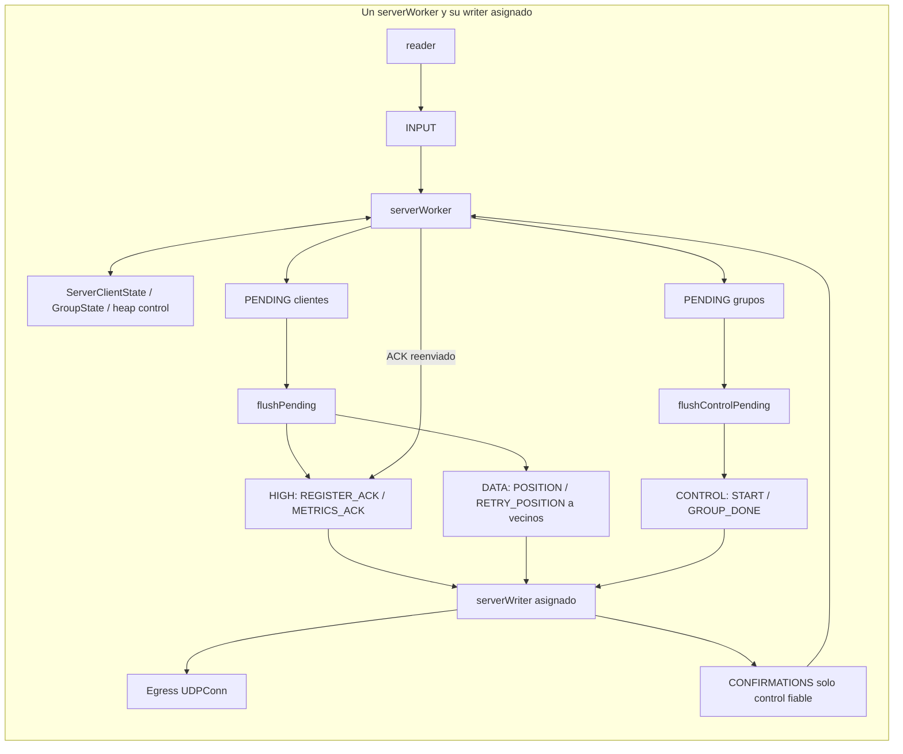

# Arquitectura actual

La configuración local validada en 6A ejecuta **un servidor y dos generadores para 160.000 clientes lógicos**, con V=25 e I=5. Cada cliente es un valor `ClientState` dentro de un array: sus IDs, fase, coordenadas, máscara ACK, RTT y ARQ. N=160000 mantiene el número de lectores, writers y timers de N=30000; aumenta el estado preasignado. El contrato y la semántica se explican en [PROTOCOLO_Y_FLUJOS](PROTOCOLO_Y_FLUJOS.md).

| Proceso | Workers / GOMAXPROCS | Reader / writers / sockets |
|---|---:|---|
| Server | 6 / 6 | 1 / 3 / 4: ingress + tres egress |
| Generator 1 | 3 / 3 | 1 / 1 / 1 |
| Generator 2 | 3 / 3 | 1 / 1 / 1 |

Estos valores son overrides explícitos de la referencia local; los defaults públicos conservan la configuración inicial.

## Procesos y rutas físicas

`Server.Addr()` es el único destino de solicitudes. `openEgress()` abre tres sockets TX con puertos efímeros y **sin readers**; `EgressEndpoints()` publica sus direcciones. El supervisor comunica estas fuentes exactas a ambos generadores mediante `-server-egress-endpoints`. Una lista explícita sustituye la fuente canónica; no se aceptan respuestas de puertos arbitrarios. El binding del endpoint del generador ocurre con REGISTER y permanece estable durante el run. El flag de dirección no sustituye esta comprobación de IP/puerto.

## Rangos y ownership

`Manifest` es una copia inmutable creada por `NewManifest`: mismo RunID/N/V/I, cobertura exacta de 1..N, sin huecos, solapamientos ni grupos partidos. `GeneratorID` identifica el proceso lógico; no es un ClientID. El servidor deriva ClientID/GroupID del nonce y el generador solo acredita registro después de REGISTER_ACK.

En S, owner=`(GroupID-1)%6`. En G, owner=`((ClientID-FirstID)/V)%3`; el reparto usa grupos locales de base cero. Los 25 integrantes de un grupo quedan juntos en cada extremo. Solo su worker accede al estado mutable. Reader y writer transportan valores; tickets y contadores atómicos coordinan cancelación/observación sin que el writer lea `ClientState` o `GroupState`.

## Colas y backpressure reales

Todas las colas de trabajos son `boundedQueue[T]`: anillos de capacidad fija, mutex local y sin locks retenidos durante I/O. Los canales `wake` son avisos coalescidos, no colas de paquetes. Los readers realizan validación y admisión INPUT no bloqueante: un INPUT lleno descarta y contabiliza; no realizan fanout.

S no tiene cola RETRY independiente: fanout selectivo de RETRY_POSITION va a DATA y reintentos START/GROUP_DONE a CONTROL. PENDING guarda índices e intenciones, no copias infinitas de datagramas. Está dimensionado por clientes/grupos propios; una entrada como máximo por objeto. El dequeue del writer despierta al owner para reintentar admisión.

| Capacidad por worker | S | Cada G |
|---|---:|---:|
| INPUT | 4096 | 4096 |
| HIGH | 1024 | 2048 |
| CONTROL | 256 | 128 |
| DATA | 2048 | 2048 |
| RETRY | no existe | 512 |
| CONFIRMATIONS | 256 | 256 |
| COMMANDS | no existe | 256, sin uso en modo académico |
| PENDING clientes | clientes propios | clientes propios |
| PENDING grupos | grupos propios | no existe |

`FullAttempts` cuenta intentos contra cola llena incluso cuando se conserva la intención; `Drops` cuenta descartes efectivos. No son equivalentes. La baseline mantiene la admisión histórica y sus FullAttempts; el experimento `-optimize-data-admission` sigue disponible y desactivado.

## Ventanas, pacing y prioridades

PositionWindow limita **POSITION propias efectivamente admitidas**, hasta recepción de todas las respuestas y confirmación del write inicial; no limita el servicio de vecino. Cada G tiene ventana 64: suma 128. Los retries de esa operación no consumen otro slot. RegisterWindow 64 por G aplica al registro inicial.

Cada G limita POSITION inicial con un bucket 10000/s, burst 1; REGISTER inicial tiene pacing 20000/s, sin ráfaga adicional; RETRY tiene bucket 50/s, burst 1. Un backlog RETRY retiene admisión de nuevas POSITION incluso si espera tokens. Los ACK reactivos no usan estos buckets. S limita START/GROUP_DONE con un único bucket 40000/s, burst 1, compartido mediante lease; HIGH/DATA no usan ese lease ni un limitador DATA adicional.

Las cuotas dan servicio entre clases elegibles, sin pausas artificiales. S usa HighBurst 8 y alterna turnos inferiores CONTROL/DATA; G usa HighBurst 24 para HIGH/CONTROL antes de RETRY/DATA y AckBurst 4 para alternar ACK/control. No significa un ratio rígido permanente: elegibilidad, tokens, confirmaciones y ventanas también intervienen.

## ARQ, timers y cierre

ARQ nominal 1→2→4→5 segundos, jitter determinista entre 80–100 % del RTO y máximo 12 envíos por operación incluyendo el inicial. Reintentos selectivos conservan MessageID/iteración/coordenadas. Un heap indexado mantiene una entrada por cliente activo en G y por grupo activo de control en S; cada worker reutiliza un timer. Cada writer reutiliza un timer de pacing. No hay timer por cliente.

La biblioteca tiene W+K+2 goroutines propias en S = 11 y W+3 por G = 6: 23 en total. Hay 6 timers de control+3 de writer en S y 3 ARQ+1 writer por G. CLI, supervisor de medición, runtime y helpers añaden recursos fuera de estos conteos.

La CLI tiene deadline administrativo 10 min para todo el proceso y write deadline 1 s. **No hay Idle Timeout en esta implementación multiplexada**, ni cierre a 30 s: el éxito requiere todas las barreras y GROUP_DONE_ACK. Los generadores permanecen activos después de METRICS y de su DONE local hasta comprobar la prueba final del servidor. Véase la dependencia local de esa prueba en [próxima fase](DISTRIBUIDO.md).

`Stats()` publica contadores atómicos y snapshots de colas; los grupos usan snapshots con secuencia. La medición externa muestrea colas 250 ms, procesos 1 s y runtime al principio/final. Solo estos snapshots usan mapas/JSON: el codec y estado por datagrama usan valores tipados preasignados. [Resultados](FASES_Y_RESULTADOS.md) define denominadores, RSS y límites de interpretación.
