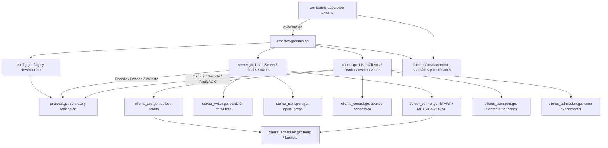

# Guía práctica del código

Si quieres entender el proyecto, lee los archivos en este orden:

1. `protocol.go`: el contrato y el manifiesto.
2. `cmd/arc-go/main.go`: cómo se ejecuta cada proceso.
3. `server.go`: recepción, propietarios y enrutamiento.
4. `server_control.go`: barreras y cierre fiable.
5. `server_writer.go`: partición y observación de writers.
6. `server_transport.go`: sockets TX independientes.
7. `clients.go`: clientes lógicos y dataplane del generador.
8. `clients_control.go`: avance académico automático.
9. `clients_arq.go`: recuperación selectiva y cancelación.
10. `clients_scheduler.go`: deadlines y token buckets.

El módulo `arc.local/multiplexado` mantiene el paquete raíz llamado `protocol`, que también contiene Server y ClientGenerator. Los archivos de la raíz comparten paquete: sus relaciones son llamadas entre funciones, no imports entre archivos. `cmd/` contiene ejecutables; `internal/measurement/` observa y certifica. Los 21 fuentes y 37 tests se conservan byte a byte.

## Dependencias y llamadas reales

El supervisor lanza procesos separados. Los readers validan y despachan; los owners modifican clientes/grupos; los writers consumen trabajos por valor. [ARQUITECTURA](ARQUITECTURA.md) describe las colas y [PROTOCOLO_Y_FLUJOS](PROTOCOLO_Y_FLUJOS.md), los estados y el wire format.

## Los diez archivos principales

### 1. Contrato común

**RUTA:** [protocol.go](../protocol.go).

**QUÉ HACE:** define Header, Packet, payloads, mensajes, Encode/Decode, Manifest y máscaras ACK. Valida el formato y asigna identidades mediante el rango autorizado.

**QUIÉN LO LLAMA:** configuración CLI, readers, writers y owners de ambos extremos.

**QUÉ ESTADO CONTIENE:** estructuras por valor y manifiesto inmutable; no sockets, colas ni estado mutable de simulación. Encode/Decode trabajan sobre almacenamiento preasignado del llamante.

**CON QUÉ OTROS ARCHIVOS SE RELACIONA:** config.go, server.go, clients.go y sus controles. Es la referencia para todas las correlaciones de RunID/ID/iteración/MessageID.

### 2. Ejecución de un proceso

**RUTA:** [cmd/arc-go/main.go](../cmd/arc-go/main.go).

**QUÉ HACE:** selecciona `server` o `client`, arranca la biblioteca, publica READY, muestrea métricas y escribe el resultado final. Gestiona contexto, señales, deadline y perfiles opcionales.

**QUIÉN LO LLAMA:** la terminal o arc-bench, como ejecutable separado.

**QUÉ ESTADO CONTIENE:** contexto del proceso, Report y Sampler. El generador espera la prueba JSON del servidor tras DONE lógico antes de cerrar su socket.

**CON QUÉ OTROS ARCHIVOS SE RELACIONA:** config.go, ListenServer/ListenClients e internal/measurement. La coordinación por archivo es una dependencia local pendiente para distribuido.

### 3. Núcleo del servidor

**RUTA:** [server.go](../server.go).

**QUÉ HACE:** define Server, serverWorker, ServerClientState, GroupState y boundedQueue. `ListenServer` reserva recursos; reader/decodeDispatch admiten INPUT; handle registra y enruta; flushPending convierte intenciones en HIGH/DATA. Aquí también están los loops de consumo y write del servidor.

**QUIÉN LO LLAMA:** CLI `serve`; después, sus propias goroutines de reader, workers, writers y supervisor.

**QUÉ ESTADO CONTIENE:** clientes y grupos preasignados por owner, colas bounded, pending, bindings y contadores. Solo el worker propietario modifica el estado de su grupo.

**CON QUÉ OTROS ARCHIVOS SE RELACIONA:** protocol.go valida mensajes; server_control.go mantiene control fiable; server_writer.go particiona consumidores; server_transport.go abre egress.

### 4. Control fiable del servidor

**RUTA:** [server_control.go](../server_control.go).

**QUÉ HACE:** abre START tras N registros, acepta METRICS idempotentes, prepara GROUP_DONE y exige todos los ACK de cierre. Gestiona masks, rondas, RTO, tickets, confirmations y el bucket CONTROL compartido.

**QUIÉN LO LLAMA:** serverWorker.run/handle y selectores del writer; CLI/tests esperan `WaitSimulationComplete` y consultan GroupStats.

**QUÉ ESTADO CONTIENE:** fase y máscaras por grupo, suma RTT de 128 bits, heap indexado de control, gates atómicos y snapshots. Un timer por owner, no por cliente.

**CON QUÉ OTROS ARCHIVOS SE RELACIONA:** server.go, server_writer.go y los tipos heap/bucket de clients_scheduler.go. La comprobación final exige todas las barreras, no solo N métricas.

### 5. Writers y reparto del servidor

**RUTA:** [server_writer.go](../server_writer.go).

**QUÉ HACE:** define serverWriter y su partición exclusiva de workers; notifica consumidores, libera el lease CONTROL y publica métricas por writer/clase. Mantiene wrappers usados por fixtures de un writer.

**QUIÉN LO LLAMA:** arranque, selectores, writes y Stats del servidor.

**QUÉ ESTADO CONTIENE:** socket asignado, workers, cursores/cuotas, wake y contadores del consumidor. Las publicaciones durante el run pueden retrasarse; tras Close son finales.

**CON QUÉ OTROS ARCHIVOS SE RELACIONA:** server.go contiene el loop de write; server_control.go aporta lease/confirmations y server_transport.go asigna el UDPConn.

### 6. Transporte físico del servidor

**RUTA:** [server_transport.go](../server_transport.go).

**QUÉ HACE:** `openEgress` asigna conexiones; con un socket reutiliza ingress y con dos/tres crea egress TX exclusivos. Cierra arranques parciales y expone EgressEndpoints/estadísticas físicas.

**QUIÉN LO LLAMA:** ListenServer, cierre y publicación READY/Stats.

**QUÉ ESTADO CONTIENE:** conexiones y mapping writer/socket/endpoint fijados antes de arrancar goroutines. No contiene estado de clientes ni readers en los egress.

**CON QUÉ OTROS ARCHIVOS SE RELACIONA:** server.go/server_writer.go; el supervisor comunica sus endpoints a clients_transport.go mediante configuración CLI.

### 7. Núcleo del generador

**RUTA:** [clients.go](../clients.go).

**QUÉ HACE:** define ClientGenerator, ClientState y clientWorker. Registra, sirve POSITION de vecinos y procesa ACK; beginPosition/finishOperation acreditan una operación; writer codifica, aplica cuotas y pacing, envía y publica el receipt.

**QUIÉN LO LLAMA:** CLI `generate`; luego sus propios reader, owners, writer y supervisor. `StartPosition` solo se usa con Academic=false en fixtures.

**QUÉ ESTADO CONTIENE:** array compacto de clientes por owner, masks, RTT, flags, pending y colas INPUT/HIGH/CONTROL/DATA/RETRY/CONFIRMATIONS/COMMANDS. Un socket por G. El writer no lee ClientState mutable.

**CON QUÉ OTROS ARCHIVOS SE RELACIONA:** protocol.go, clients_control.go, clients_arq.go, clients_scheduler.go, clients_transport.go y la rama experimental clients_admission.go.

### 8. Flujo académico del generador

**RUTA:** [clients_control.go](../clients_control.go).

**QUÉ HACE:** procesa START, genera coordenadas reproducibles, avanza I operaciones y envía METRICS. Responde START_ACK/GROUP_DONE_ACK y mantiene servicio de vecino hasta cierre. `WaitAllDone` acredita finalización lógica.

**QUIÉN LO LLAMA:** owner al recibir control o terminar una operación; CLI espera WaitAllDone.

**QUÉ ESTADO CONTIENE:** flags/fases del cliente propietario y señal de finalización por G. Reutiliza colas y timers existentes, sin recursos por cliente.

**CON QUÉ OTROS ARCHIVOS SE RELACIONA:** clients.go y clients_arq.go; server_control.go implementa el otro extremo del intercambio. La CLI mantiene G vivo hasta el certificado S.

### 9. ARQ y cancelación

**RUTA:** [clients_arq.go](../clients_arq.go).

**QUÉ HACE:** calcula backoff/jitter, arma deadlines desde el write confirmado, solicita retries selectivos y declara fallo al agotar envíos. Tickets/claim atómico cancelan trabajos obsoletos; controla slots inflight y backlog RETRY.

**QUIÉN LO LLAMA:** owner al recibir confirmations/ACK o vencer deadlines; writer al reclamar/cancelar un outbound.

**QUÉ ESTADO CONTIENE:** deadlines y gates/tickets asociados al cliente, heap del owner y contadores inflight atómicos. Las retransmisiones pasan por RetryRate; no hay bypass.

**CON QUÉ OTROS ARCHIVOS SE RELACIONA:** clients.go, clients_control.go y clients_scheduler.go. El retry conserva correlación y t0 inicial de RTT.

### 10. Heap y token buckets

**RUTA:** [clients_scheduler.go](../clients_scheduler.go).

**QUÉ HACE:** mantiene heap indexado con una entrada por cliente activo y buckets fixed-point con reloj monotónico. Calcula elegibilidad y próximo deadline sin crear timers nuevos.

**QUIÉN LO LLAMA:** ARQ/owner para heap y writer G para pacing; server_control.go reutiliza el bucket bajo lease.

**QUÉ ESTADO CONTIENE:** array fijo de índices, HeapIndex/Deadline del cliente propietario; balance/capacidad/rate/updatedAt del bucket. No I/O ni locks en el heap propietario.

**CON QUÉ OTROS ARCHIVOS SE RELACIONA:** clients_arq.go, clients.go y server_control.go; el loop propietario reutiliza su timer para esperar.

## Los otros once fuentes, cuando hagan falta

| Ruta | Responsabilidad / llamante / estado |
|---|---|
| [cmd/arc-go/config.go](../cmd/arc-go/config.go) | parsea flags/rangos y construye Manifest/configs para main; valida antes de bind, conserva defaults históricos |
| [clients_transport.go](../clients_transport.go) | lista fija de hasta tres fuentes S autorizadas; reader consulta IP/puerto, TX sigue al ingress |
| [clients_admission.go](../clients_admission.go) | admisión experimental 5K llamada si el flag está activo; marcas/contadores del owner, baseline false |
| [internal/measurement/report.go](../internal/measurement/report.go) | snapshots, sampler, certificados, ValidateProof y JSON atómico usados por CLI/supervisor; mapas fuera del hot path |
| [internal/measurement/generator_writer.go](../internal/measurement/generator_writer.go) | deriva writes por clase de contadores después de Close; CLI lo incorpora al Report |
| [cmd/arc-bench/main.go](../cmd/arc-bench/main.go) | lanza/supervisa procesos y mide CPU/RSS con herramientas macOS; estado externo del experimento |
| [cmd/arc-bench/multigenerator.go](../cmd/arc-bench/multigenerator.go) | reparte dos G con grupos íntegros y presupuestos agregados, espera/certifica resultados; el supervisor soporta uno/dos G |
| [cmd/arc-bench/summary.go](../cmd/arc-bench/summary.go) | medias/min/max de JSON históricos; summarize legacy rechaza multigenerador, los auditores externos están archivados |
| [cmd/arc-bench/priority.go](../cmd/arc-bench/priority.go) | helpers puros para flags HIGH de G, llamados por supervisor |
| [cmd/arc-bench/transport.go](../cmd/arc-bench/transport.go) | valida READY y transforma ingress/fuentes egress en configuración G |
| [cmd/arc-bench/admission.go](../cmd/arc-bench/admission.go) | añade el flag experimental de admisión solo cuando true |

## Tests conservados

Los **37 `_test.go`** cubren codec/manifiesto, V=1/25/32, server/dataplane/control/shards, generator/ARQ/prioridades/capacidad, admisión experimental, simulación completa, recursos, CLI, supervisor y medición. Las pruebas de pérdida dirigida y agotamiento comprueban recuperación y fallo explícito. Los benchmarks históricos y semillas fuzz siguen disponibles; esta entrega ejecuta tests normales/race/vet/build y no benchmarks ni cargas grandes.
