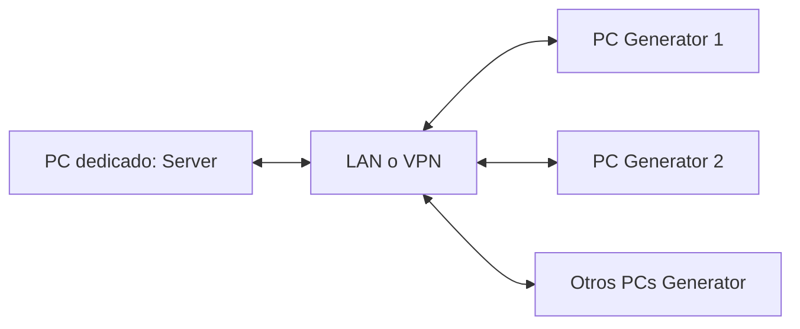

# Próximo paso: ejecución distribuida

Estado actual: **160.000 clientes lógicos validados localmente**, un servidor y dos generadores en el mismo Mac. El código y la semántica están congelados; esta entrega solo prepara la lectura y conserva evidencias.

El siguiente diseño situará el servidor en un PC dedicado y los generadores en varios PCs conectados mediante LAN o VPN. Los equipos podrán usar Windows, Linux o macOS, sujetos a adaptación y validación por plataforma. La prueba local no acredita rendimiento ni compatibilidad del despliegue distribuido.

## Qué habrá que adaptar y revalidar

| Área | Trabajo pendiente |
|---|---|
| Coordinación | `arc-bench` solo lanza uno/dos G locales. READY y certificados JSON usan disco compartido; `arc-go client` espera `-server-result` antes de cerrar. Diseñar arranque y entrega de la prueba final entre PCs preservando todas las barreras. |
| Plataformas | Revalidar build/tests de Go, procesos, señales, rutas y certificados en Windows/Linux/macOS. El supervisor y la medición actuales usan `ps` y `/usr/bin/time -l` de macOS; necesitan adaptación. |
| Manifiesto | RunID/N/V/I idénticos, cobertura completa y rangos alineados con V. Cuatro rangos de 40.000 serían válidos para 160K/V25; el supervisor actual no implementa ese despliegue. |
| Endpoints | IPs alcanzables, bind de ingress/egress, fuentes exactas anunciadas y endpoints estables del generador. Revalidar firewall, rutas y efectos de NAT/VPN sobre IP/puertos. |
| Red y SO | Medir MTU, buffers efectivos, NIC/enlace, paquetes y bytes/s, jitter y pérdidas por extremo. La fórmula de 73 datagramas por operación conserva su amplificación. |
| Presupuestos | Revalidar ventanas, pacing agregado, RetryRate/RTO, workers y shards con RTT/capacidad reales. No trasladar las conclusiones de loopback como una capacidad LAN/VPN demostrada. |
| Correctness y cierre | Empezar con carga pequeña y pérdidas dirigidas: registro, START, ACK únicos, métricas verificadas, GROUP_DONE_ACK y certificado final recibido por todos los PCs. |

La etapa distribuida requiere diseño y autorización propios. **No se implementa ni se inicia en esta entrega.**
