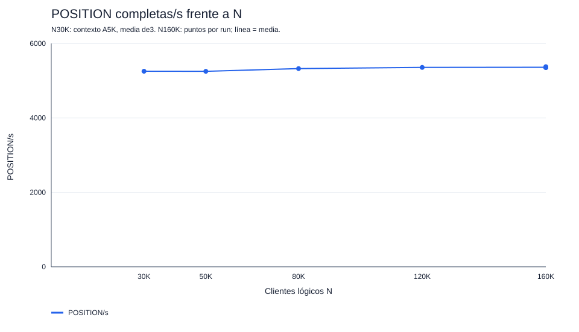
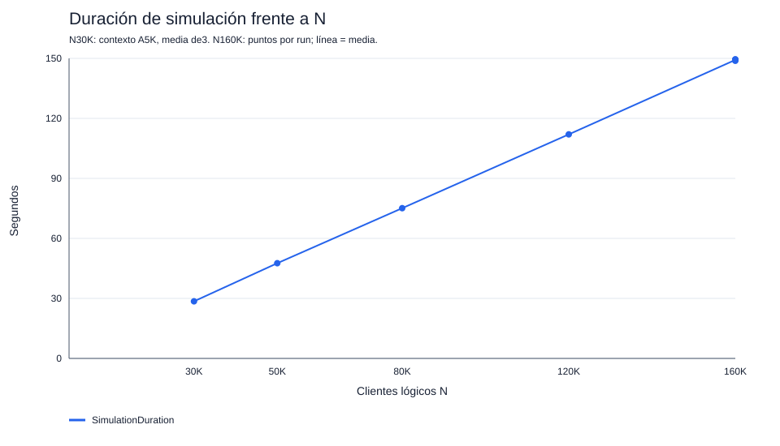
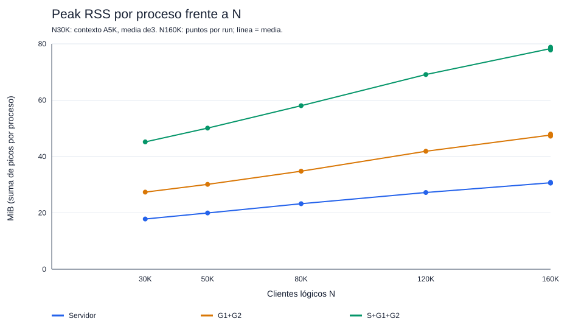
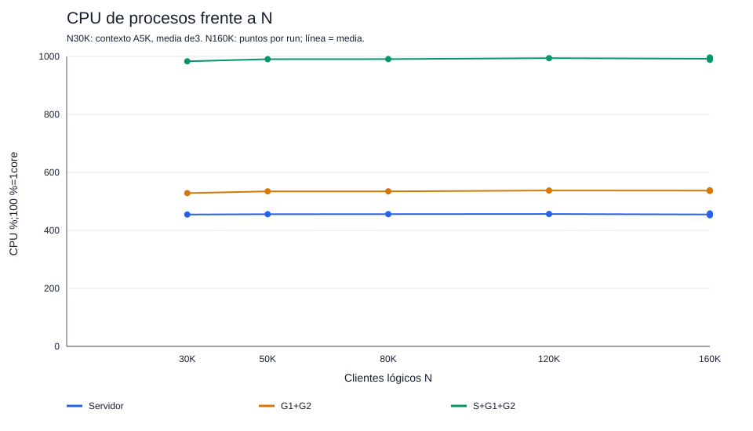

# Evolución del proyecto

**Resultado final local: 160.000 clientes, V=25/I=5, estables en 3/3 ejecuciones.** Media: **5.360 POSITION completas/s, RTT 22,651 ms y RSS total 78,318 MiB**, con **59.680.000 datagramas por ejecución**. Se cerró la etapa local sin buscar un máximo ni probar 200K.

## Fases 1–4

Construcción y correctness antes de medir grandes cargas:

| Fase | Entrega | Evidencia aprobada |
|---|---|---|
| 1 | codec binario v1 de 64 B, manifiesto alineado y ACK/missing masks uint32 | V=1/25/32, roundtrip, inválidos, fuzz; Encode/Decode POSITION/ACK históricos: 0 B/op y 0 allocs/op |
| 2 | servidor con reader, owners por grupo, colas bounded y writer | registro autoritativo, fanout, ACK reales, duplicados/backpressure; protocolo conservado |
| 3 | generador con clientes lógicos preasignados y RTT desde write confirmado | N=100/V=25/I=1: 100 operaciones, 2.400 ACK únicos, cero descartes/fallos |
| 4A | ARQ selectivo, backoff/jitter, RetryRate y heap/tickets | pérdidas dirigidas y aproximadamente 1 % recuperadas; pérdida persistente termina al agotar envíos |
| 4B | START, cinco iteraciones, METRICS y GROUP_DONE fiables | N=100/V=25/I=5: 500 operaciones, 12.000 ACK y todas las barreras; tests de pérdidas y cierre |

Tests/race/vet aprobados en sus entregas. Los microbenchmarks de estas fases miden caminos concretos, no throughput de sockets. No se ejecutan nuevos benchmarks durante la limpieza.

## Fase 5

Optimización mediante experimentos de aislamiento. S indica servidor, G generador; los resultados A→B son medias de las variantes de **esa subfase**, no comparaciones causales entre filas. «Estable» exige completar y cero drops/retries naturales/timeouts/errores/fallos; completar con recovery no basta.

| Subfase | Cambio | Resultado | Decisión |
|---|---|---|---|
| 5A | baseline: S con un writer/socket, un G; escalera de N y profiling separado | 10K: 2.504,5 POSITION/s y RTT 50,998 ms; 30K: 2.612,9/s y 48,801 ms; estables 3/3 | aislar ventana; ruta de salida/admisión como hipótesis |
| 5B | 10K, PositionWindow 128→256 | 2.450,91→2.492,33/s (+1,69 %), RTT 52,104→102,319 ms; estables 3/3 | mantener 128: mayor ventana añade backlog |
| 5C | 10K, uno→dos writers sobre el mismo UDPConn S | 2.505,51→2.424,31/s (−3,24 %); estables 3/3 | más writers sobre un FD no crean capacidad; aislar sockets |
| 5D | 10K, dos writers: un FD compartido→dos egress exclusivos | +26,55 % (2.411,29→3.051,59/s), pero HIGH G descarta 445–1.800/run; B estable 0/3 | experimento útil, todavía no baseline |
| 5E | 10K, HighBurst G 8→24 | +10,68 %; drops medios 1.000,67→52,33/run; estabilidad 0/3→1/3 | mejora el servicio ACK; probar capacidad HIGH |
| 5F | 10K, HIGH G 1024→2048, cuota 24 fija | +6,78 % (3.186,06→3.402,11/s), estabilidad 0/3→3/3 | candidata: dos egress S, H24/HIGH2048 |
| 5G | candidata a 30K | 3.454,21/s, RTT 36,056 ms; 150.000 operaciones/3,6 M ACK, estable 3/3 | validar y volver a aislar ventana |
| 5H | 30K, PositionWindow 128→256 | −0,62 % (3.462,23→3.440,65/s), RTT 36,295→72,621 ms; estabilidad 3/3→2/3 | mantener 128 |
| 5I | 30K, un G W6/P6→dos G W3/P3, presupuestos agregados iguales | +34,44 % (3.471,15→4.666,66/s), RTT 35,397→26,977 ms; ambas estables 3/3 | la ruta G única contribuía; no atribuir todo solo al socket |
| 5J | 30K, dos→tres pares writer/egress S, dos G | +14,35 % (4.639,10→5.304,95/s); ambas estables 3/3, desaparece presión DATA S observada | mantener tres shards para siguiente experimento |
| 5K | 30K, admisión histórica→optimizada | FullAttempts DATA ≈440,06 M/run→0 y CPU G −8,23 %, pero throughput −2,27 % (5.253,733→5.134,293/s); ambas estables 3/3 | no adoptar: flag false, cerrar microoptimización local |

Las mejoras parciales identifican contribuciones, no una única causa física. FullAttempts mide admisión contra cola llena con intención retenida, distinto de QueueDrops y de retransmisión UDP. Los perfiles adicionales no se mezclan con referencias. La comparación antigua con Python/TCP no tiene una carga/medición equivalente que permita acreditarla.

## Fase 6

### Escalabilidad local

6A varió únicamente N con binarios y configuración congelados, sin profiling. 30K es contexto de tres A históricas de 5K; 50K/80K/120K tienen una referencia nueva cada uno y 160K tiene tres. No se presentan las observaciones únicas como tres repeticiones.

| N | SimulationDuration (s) | POSITION/s | RTT (ms) | CPU total (%) | RSS total (MiB) | Estable |
|---|---:|---:|---:|---:|---:|---|
| 30K, contexto | 28,551 | 5.253,733 | 23,027 | 983,245 | 45,198 | 3/3 histórico |
| 50K | 47,605 | 5.251,562 | 23,237 | 990,497 | 50,094 | 1/1 |
| 80K | 75,119 | 5.324,858 | 23,010 | 990,774 | 58,047 | 1/1 |
| 120K | 112,014 | 5.356,464 | 22,808 | 994,070 | 69,109 | 1/1 |
| 160K, media | **149,251** | **5.360,138** | **22,651** | **992,035** | **78,318** | **3/3** |
| 160K, mín.–máx. | 148,803–149,498 | 5.351,238–5.376,238 | 22,508–22,850 | 988,275–996,362 | 77,812–78,812 | — |

POSITION/s = operaciones completas / SimulationDuration. RTT = write inicial hasta último ACK único, excluyendo espera anterior al write. CPU externa = `100 × (user+sys)/real`; 100 % representa un core. RSS total suma los picos de S/G1/G2, no un pico simultáneo. Los TX/RX por proceso usan su propio ProcessDuration; no sumar TX y RX para contar datagramas nuevos.

En cada ejecución 160K se acreditan 160.000 registrados, START_ACK, métricas, DONE y GROUP_DONE_ACK; **800.000 operaciones, 19.200.000 ACK únicos, 6.400 grupos completos y SimulationComplete=true**. Cero QueueDrops, retries naturales, timeouts, errores de socket y fallos terminales; colas/heaps/inflight vacíos al cierre.

Con 24 vecinos, una operación usa `1 + 24 + 24 + 24 = 73` datagramas. Cinco iteraciones usan `365N` DATA; los cuatro intercambios de control usan `8N`. Total físico sin pérdidas: **`373N = 59.680.000` para N=160000**, incluidos 58.400.000 DATA. Se conservan todos los saltos UDP aunque el grupo pertenezca al mismo G.

### Configuración y límites de interpretación

Host de referencia: Apple M4 Pro, 12 CPUs lógicas/24 GiB, Darwin 25.6.0, Go 1.27.1 darwin/arm64, CGO_ENABLED=1. S W6/GOMAXPROCS6, tres writers/egress más ingress; dos G W3/GOMAXPROCS3 y un socket/writer por G. Ventana/rates agregados G: POSITION 128 y 20.000/s, REGISTER 128 y 40.000/s, RETRY 100/s. HIGH G 2048, HighBurst 24; RTO 1→2→4→5 s, jitter 20 %, máximo 12 envíos; admisión histórica. Los restantes parámetros están en [ARQUITECTURA](ARQUITECTURA.md).

Buffers solicitados 4 MiB, write deadline 1 s, contexto administrativo 10 min. Sin cambios de kernel/ulimit durante las referencias: recvspace 786896, maxdgram 9216, maxsockbuf 8388608, FD 1048575 y procesos 4000 observados. Estos valores describen el host; solicitar 4 MiB no acredita el buffer efectivo.

Throughput aproximadamente constante: +2,03 % entre el contexto 30K y 160K. La duración crece con el trabajo; el RSS es compatible con estado aproximadamente O(N) más recursos fijos. En 160K no se observó presión importante de GC: ciclos S/G1/G2 = 3/2/2 y suma de pausas 0,478–0,567 ms. Las capturas de heap inicial/final no son peak heap.

La admisión histórica conserva **≈2.497,23 M FullAttempts DATA/run (≈16,73 M/s)**. Es coste conocido, no pérdida de datagramas. DATA G continúa bajo presión; estos resultados acreditan corrección local, no un máximo ni capacidad distribuida.

### Gráficas

Originales generados con Go en 6A, conservados byte a byte. Muestran siete puntos: contexto 30K y seis referencias nuevas, incluidos tres 160K. Las líneas son descriptivas.

### Entrega 6B e histórico

La reorganización solo cambia documentación y ubicación de evidencias: 21 fuentes, 37 tests y go.mod se mantienen byte a byte. No se ejecutan benchmarks ni nuevas referencias grandes. La siguiente etapa queda descrita en [DISTRIBUIDO](DISTRIBUIDO.md), sin implementar.

`archivo/evidencias_locales.tar.gz` conserva la estructura previa completa, inventarios, auditorías, CSV/JSON, informes originales y los tres tar.gz anteriores **sin modificar sus bytes**. Su inventario interno permite verificar cada miembro. `archivo/SHA256SUMS.txt` verifica el archivo exterior. Las evidencias detalladas 5A–5K y 6A permanecen en los tar.gz interiores; para consultarlas, extraer fuera del árbol activo, por ejemplo en un directorio temporal.
