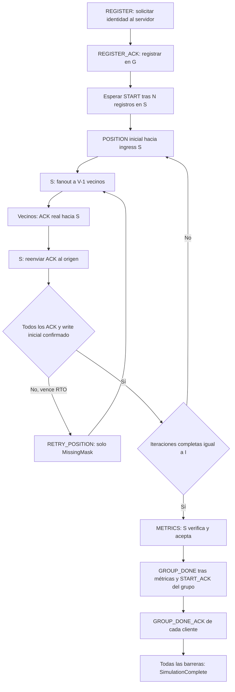
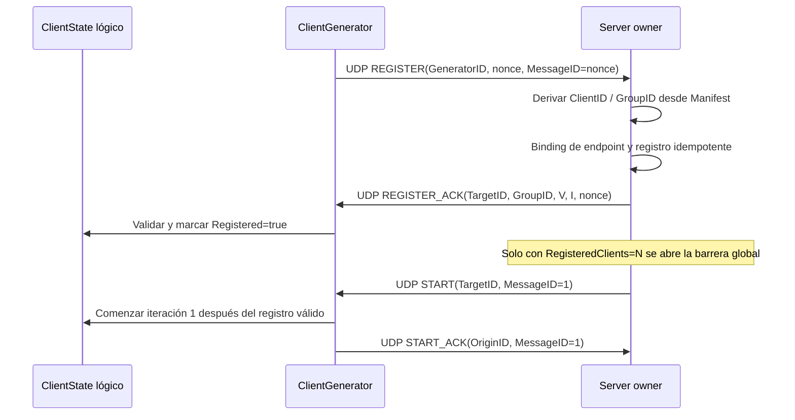
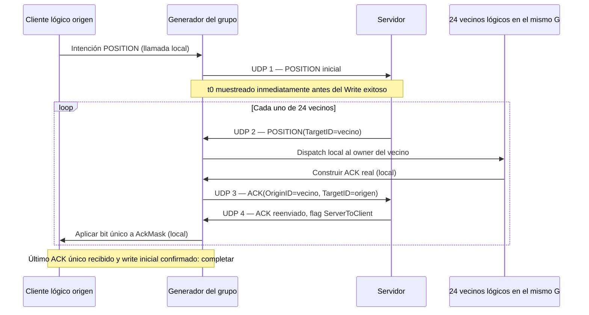
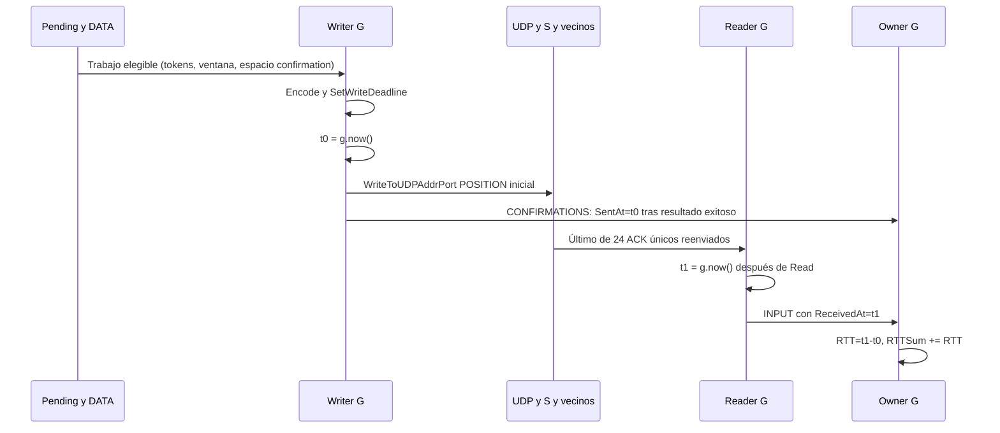
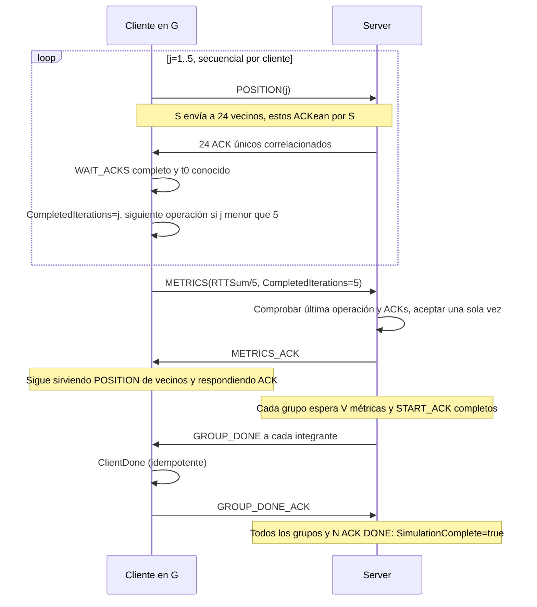
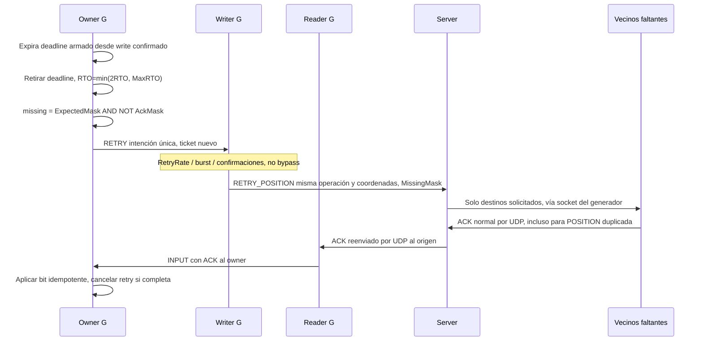
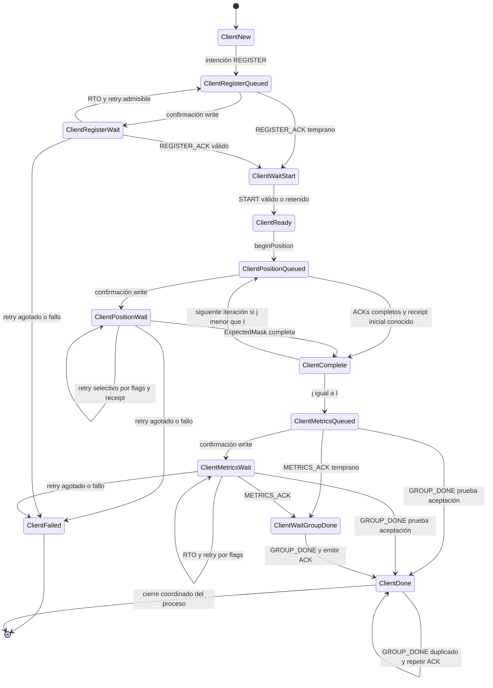
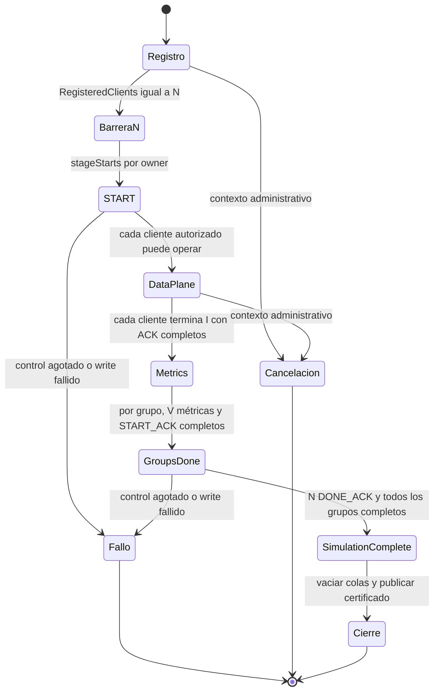

# Protocolo y flujos

Especificación del formato v1 y del comportamiento actual. La semántica académica se mantiene en cada tramo UDP.

## Protocolo binario ARC v1

Implementación normativa: [protocol.go](../protocol.go). Enteros big-endian, floats IEEE754 binary32; codificación explícita, sin serializar la memoria del struct ni depender de padding/unsafe. Header de 64 bytes **v1 provisional para rendimiento**: se mantiene sin compresión. Una variante compacta necesitará benchmark y autorización; no se cambió en ninguna fase local.

### Header exacto

| Offset | Bytes | Campo | Regla |
|---:|---:|---|---|
| 0 | 4 | Magic | `0x41524347`, ASCII ARCG |
| 4 | 1 | Version | 1 |
| 5 | 1 | Type | códigos 1..12 |
| 6 | 2 | Flags | 0 hacia S; 1 ServerToClient; ningún otro bit |
| 8 | 8 | RunID | no nulo y común al manifiesto |
| 16 | 4 | GeneratorID | no nulo, entrada conocida |
| 20 | 4 | GroupID | `1+(ClientID-1)/V`; 0 en REGISTER o ERROR sin asignación |
| 24 | 4 | OriginID | emisor lógico del dato/ACK; 0 en registro y controles S |
| 28 | 4 | TargetID | destino lógico; 0 en peticiones a S salvo ACK |
| 32 | 4 | Iteration | 1..I en POSITION/RETRY_POSITION/ACK; 0 en controles |
| 36 | 4 | MissingMask | solo RETRY_POSITION, no vacía y subconjunto de vecinos |
| 40 | 8 | MessageID | no nulo; identidad estable de operación |
| 48 | 8 | RegistrationNonce | REGISTER/REGISTER_ACK; ERROR previo; 0 en otros |
| 56 | 2 | RetryCounter | intento/eco, uint16; POSITION inicial exige 0 |
| 58 | 2 | PayloadLength | tamaño exacto según tipo |
| 60 | 4 | Reservado | 0 |

Longitud mínima 64, máxima 80. `Decode` rechaza truncamiento, sufijos extra, payload length falso y reservados no cero; devuelve `Packet{}` ante error. `Encode` exige len suficiente y no modifica dst al rechazar. `Packet` posee valores y no retiene bytes del buffer de lectura; se reutilizan arrays `[MaxPacketSize]byte`.

### Mensajes y fiabilidad

G es el generador que representa al cliente lógico; S es servidor. POSITION/ACK siempre pasan por S. Un ACK de datos lleva OriginID=vecino y TargetID=origen de POSITION, en ambos trayectos. Al reenviar, S cambia Flags y conserva la correlación.

| Código / mensaje | Emisor → receptor | Payload / total | Propósito | Fiabilidad real | Respuesta esperada |
|---|---|---|---|---|---|
| 1 REGISTER | G → S | 0 /64 B | Solicitar identidad por GeneratorID+nonce | ARQ de G, estable e idempotente | REGISTER_ACK |
| 2 REGISTER_ACK | S → G | V, I uint32 /72 B | Asignación autoritativa ClientID/GroupID | Reactivo; repetido ante REGISTER duplicado | ninguna |
| 3 START | S → G, cada cliente | 0 /64 B | Abrir flujo tras N registros | Control fiable de S por grupo/destinos pendientes | START_ACK |
| 4 START_ACK | G → S | 0 /64 B | Confirmar START | Reactivo e idempotente | ninguna |
| 5 POSITION | G → S → G vecino | XYZ float32 /76 B | Difundir coordenadas a V−1 vecinos | Inicial; pérdidas recuperadas mediante RETRY_POSITION | ACK real de cada vecino |
| 6 RETRY_POSITION | G → S → G faltante | XYZ float32 /76 B | Recuperar subconjunto MissingMask | ARQ acotado y limitado de G | ACK normales |
| 7 ACK | G vecino → S → G origen | 0 /64 B | Confirmar recepción de POSITION | Reactivo; duplicados válidos; pérdida recuperada por retry del origen | ninguna |
| 8 METRICS | G → S | uint64 RTT + uint32 I + reservado /80 B | Media RTT y completitud académica | ARQ de G, aceptación idempotente | METRICS_ACK o GROUP_DONE que prueba aceptación |
| 9 METRICS_ACK | S → G | 0 /64 B | Confirmar aceptación | Reactivo a METRICS repetidas | ninguna |
| 10 GROUP_DONE | S → G, cada integrante | 0 /64 B | Liberar grupo con métricas completas | Control fiable de S | GROUP_DONE_ACK |
| 11 GROUP_DONE_ACK | G → S | 0 /64 B | Confirmar cierre de cliente/grupo | Reactivo e idempotente | ninguna |
| 12 ERROR | dirección S → G definida por codec | uint32 código /68 B | Formato diagnóstico reservado | **Sin handler/emisión en transporte actual** | ninguna definida |

ERROR admite códigos 1 InvalidRegistration, 2 ConflictingOperation, 3 OperationTimeout, 4 InternalError. La biblioteca de codec lo valida, pero S y G rechazan ERROR en dispatch; los fallos actuales se expresan por contadores/resultados y señales del proceso. Su presencia en la tabla no implica funcionalidad de recovery implementada.

Payload a partir de 64: POSITION X[64:68], Y[68:72], Z[72:76]; REGISTER_ACK V[64:68], I[68:72]; METRICS MeanRTTNS[64:72], CompletedIterations[72:76], reservado 0[76:80]; ERROR code[64:68]. Coordenadas finitas: NaN/Inf rechazados; cero negativo/subnormales permitidos en payload activo. Los payloads inactivos deben ser exactamente cero, incluido cero negativo en coordenadas inactivas.

### Identidad, nonce y operación

`RunConfig` valida RunID/N/I>0, 1 ≤ V ≤ 32 y N%V=0. Cada entrada `GeneratorConfig` repite la misma tupla, ID único, FirstID y Count. `NewManifest` copia y ordena al arrancar: rechaza rangos vacíos, huecos, solapamientos, extremos fuera de N, cobertura incompleta y `(FirstID-1)%V!=0` o `Count%V!=0`. Ningún grupo se reparte entre G en v1. No hay N dentro del header: proviene del manifiesto preconfigurado.

`nonce` es un ordinal local 1..Count, no una credencial aleatoria. S calcula `ClientID=FirstID+nonce-1`, `GroupID=1+(ClientID-1)/V`. REGISTER lleva OriginID/TargetID/GroupID=0. REGISTER_ACK devuelve la asignación, nonce, V/I y MessageID correctos. Deducirlos matemáticamente no acredita registro.

En modo académico: REGISTER MessageID=nonce; POSITION(j)=nonce+j; METRICS=nonce+I+1; START=1; GROUP_DONE=2. START/GROUP_DONE se correlacionan dentro de RunID/GroupID/TargetID; MessageID no es un contador global único. Respuestas copian su operación. Retries conservan ID, iteración y coordenadas; operaciones antiguas conocidas se contabilizan como stale, sin reabrir estado.

En el transporte actual, los reintentos REGISTER y METRICS conservan los bytes de la solicitud, incluido RetryCounter=0; sus intentos se contabilizan mediante Attempt interno del job. RETRY_POSITION y las rondas START/GROUP_DONE sí llevan RetryCounter en red; los ACK reactivos copian el contador recibido. El campo uint16 no sustituye el límite ARQ de envíos impuesto por el scheduler.

`Ticket` y `Attempt` en `clientOutbound`, `clientConfirmation`, `serverControlOutbound` y gates son **metadatos internos** de coordinación writer/owner. Ticket no existe en los 64 bytes. Claim atómico y máscara/ticket de control cancelan jobs obsoletos sin leer estado mutable desde un writer.

### ACK y missing masks

`GroupMask(V)=(1<<V)-1`, calculada en uint64 para V=32. `ExpectedMask` elimina el bit propio `(ClientID-1)%V`. `AckMask` acumula bits únicos; `MissingMask=ExpectedMask &^ AckMask`. `ApplyACK` verifica manifiesto, dirección, RunID, destino origen, iteración y MessageID antes de aplicar el bit del vecino. ACK tardío de otro RetryCounter de la **misma operación** sigue siendo válido; duplicado no incrementa progreso ni RTT.

| V | GroupMask | Vecinos requeridos | Ejemplo origen 1 |
|---:|---|---:|---|
| 1 | `0x00000001` | 0 | Expected=0; completa tras receipt del write inicial; RTT 0 |
| 25 | `0x01ffffff` | 24 | Expected=`0x01fffffe` |
| 32 | `0xffffffff` | 31 | Expected=`0xfffffffe`; bit 31 utilizable |

Ejemplo V=25/origen 1: recibidos bits 1..22, faltan bits 23 y 24; missing=`0x01800000`. S reenvía RETRY_POSITION únicamente a los dos IDs correspondientes y conserva la máscara solicitada en cada job. Un bit propio, fuera de V o destino cuyo bit no está solicitado se rechaza.

### Tres niveles de validación

1. Codec: framing, flags/tipo/campos obligatorios/payload/reservados/floats.
2. Manifest: RunID, rangos/grupo/generador, nonce, V/I, iteración y missing mask.
3. Owner y transporte: endpoint real, registro, fase, operación secuencial, coordenadas estables, correlación/idempotencia y métricas respaldadas por ACKs.

La suite conserva [unitarias](../protocol_test.go), [fuzz](../protocol_fuzz_test.go) y [benchmarks](../protocol_bench_test.go): V=1/25/32, roundtrip/vectores exactos, masks y duplicados, truncados/sufijos, tipos/versiones/reservados inválidos, RunID/ID/iteración/nonce/rangos inválidos, floats y buffers cortos. Los cuatro benchmarks Encode/Decode POSITION/ACK dieron 0 B/op y 0 allocs/op en fase 1; su historia está en [Fase1](FASES_Y_RESULTADOS.md). Esta entrega conserva esos benchmarks y no los ejecuta. La suite normal ejecuta las semillas fuzz, no sustituye una campaña fuzz extendida.

## Recorrido del protocolo

Los ACK reactivos y el servicio de vecino continúan durante la espera de métricas y cierre. ARQ tiene límites de tasa e intentos; un fallo persistente se declara explícitamente.

## Flujos y estados reales

La semántica sigue registro → espera global → START → POSITION a vecinos mediante S → ACK real del vecino a S → ACK reenviado al origen → cinco iteraciones completas → METRICS → comprobación y cierre por grupo. Los ejemplos usan V=25/I=5; un grupo nunca cruza generadores en v1.

### Registro y barrera global

La barrera cuenta registros aceptados en S, no recepciones REGISTER_ACK en G. UDP puede entregar START primero: `clientPendingStart` lo retiene, sin acreditar registro ni responder START_ACK hasta un REGISTER_ACK válido. El control START se retransmite a integrantes sin ACK; el inicio no exige una segunda barrera global de START_ACK antes de servir datos.

### Una POSITION y sus cuatro tramos UDP

Los cuatro tramos describen el camino de un vecino. El tramo 1 se comparte: el total por operación es 1+24+24+24=73 datagramas, no 4×24. Aunque origen y vecinos estén en un mismo G, no se omite ninguno de los saltos UDP por S ni se sintetizan ACK por proximidad local. S solo reenvía ACK que recibió del vecino.

### Qué RTT se mide

`ClientGenerator.writer` codifica, aplica pacing/ventana y deadline, muestrea `g.now()` **inmediatamente antes** de `WriteToUDPAddrPort` inicial, y publica `SentAt` en CONFIRMATIONS si el write fue exitoso. Es timestamp monotónico de software del inicio del write efectivo, no timestamp de NIC ni muestreo posterior al syscall. `reader` muestrea `ReceivedAt` inmediatamente después de leer cada datagrama. El owner conserva el mayor timestamp de ACK únicos de la operación.

El RTT incluye syscall inicial y colas/red/recovery posteriores al primer envío. Excluye pending/pacing anteriores a t0. Un ACK puede alcanzar al owner antes que la confirmación del writer: se conserva, pero no se completa con t0 desconocido. Retransmitir no reinicia t0. Duplicados no añaden muestras. V=1 no espera vecinos y su RTT es 0.

### Iteraciones y finalización

GROUP_DONE prueba aceptación de métricas incluso si METRICS_ACK se perdió; el cliente valida que completó I antes de aceptarlo. Un GROUP_DONE duplicado obtiene otro ACK. `WaitAllDone` indica DONE lógico, no entrega efectiva del último ACK: la CLI conserva G vivo hasta la prueba JSON de S, vacía sus colas y cierra. S espera sus colas vacías después de completitud. No hay mensaje UDP nuevo de cierre global.

### ARQ selectivo

La operación sigue pendiente mientras hay admisión/receipt por confirmar, sin otro deadline que duplique el retry. ACK tardíos de intentos anteriores de la misma operación siguen siendo útiles. Un job cancelado antes del claim no se envía; uno ya reclamado puede producir un duplicado inocuo. Pérdida persistente termina en `ClientFailed` al agotar 12 envíos; el protocolo no garantiza entrega ante pérdidas permanentes. START/GROUP_DONE aplican la misma política acotada con masks por grupo.

### Ciclo de vida del cliente

Este es un diagrama semántico. En el código el retry de POSITION puede mantener `ClientPositionWait` y el de METRICS `ClientMetricsWait` mientras sus flags de intención/receipt cambian; no hay una fase `Retry` pública. Cualquier operación activa puede fallar por write/timestamp; la cancelación del owner marca `ClientStopped` donde corresponde. `ClientComplete` es transitorio en modo académico, estable para la API manual de fixtures.

### Ciclo global y grupos del servidor

Las etapas globales se solapan entre grupos; no son un enum global secuencial. El enum real por grupo es `ServerGroupIdle → Starting → Running → Finishing → Complete`, con `Failed` como terminal. S exige N registrados, N START_ACK, N métricas, N GROUP_DONE_ACK, N/V grupos completos y cero fallos de control antes de señalar completitud.
