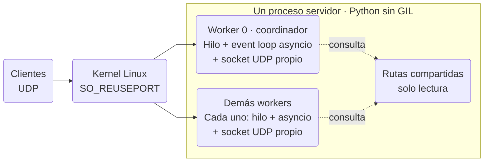
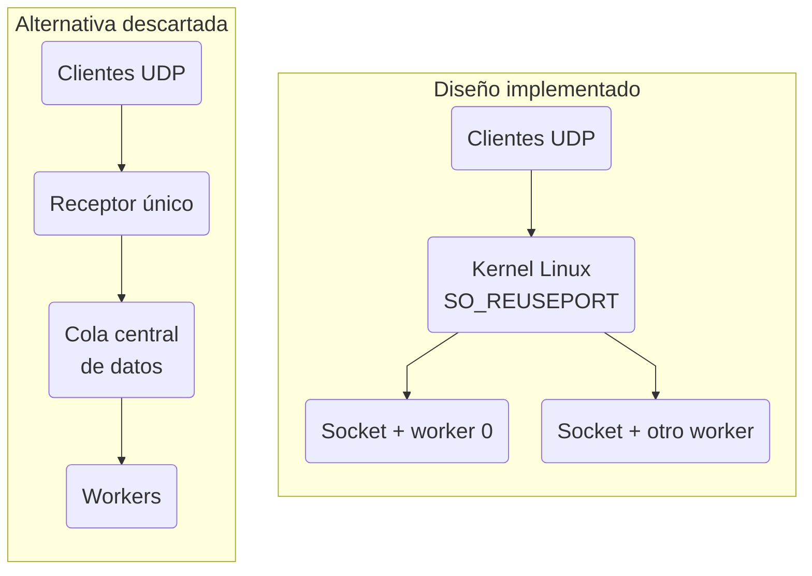

# Arquitectura y uso del proyecto UDP

La simulación registra N clientes lógicos, forma grupos por orden real de registro y ejecuta I operaciones POSICION/ACK por cliente. V incluye al propio cliente: cada operación espera V−1 ACK de vecinos distintos. El servidor es intermediario para todos los datos. El protocolo se detalla en [PROTOCOLO.md](PROTOCOLO.md); los problemas corregidos, pruebas y mediciones están en [CAMBIOS_UDP.md](CAMBIOS_UDP.md).

## Instalación y ejecución

Trabajar desde `udp/`. Servidor definitivo: Linux y CPython free-threaded con GIL desactivado. Docker Desktop proporciona ese Linux en el Mac. Los procesos usan solo la biblioteca estándar; no hace falta instalar paquetes Python ni Matplotlib. El controlador host y los generadores admiten Python >=3.9; el Dockerfile fija CPython 3.14.10 y comprueba el SHA del tarball antes de compilarlo con `--disable-gil`.

```bash
docker build --target server -t arc-udp-server:final .
docker build --target generator -t arc-udp-generator:final .
docker run --rm arc-udp-server:final --check-runtime
```

El resultado debe mostrar `free_threaded_build=true` y `gil_enabled=false`. El control negativo siguiente **debe devolver código 1**:

```bash
docker run --rm -e PYTHON_GIL=1 arc-udp-server:final --check-runtime
```

Para una prueba completa pequeña, con cinco generadores independientes:

```bash
python3 lab.py prepare --out resultados/prueba-nueva --clients 1000 --generators 5 \
  --workers 6 -V 25 -I 5 --observe --minimum-vm-available-mib 1024 \
  --request-rate 32000 --registration-rate 2000 --retry-rate 100 \
  --position-window 64 --registration-window 64
python3 lab.py run --out resultados/prueba-nueva
```

`--out` debe ser nuevo; nunca se sobrescribe una prueba existente. `prepare` crea un manifiesto, un Compose y la configuración. `run` arranca S, espera READY y arranca G1..G5. Cada generador tiene su propia IP y directorio de resultados. El supervisor observa archivos de S para arrancar el laboratorio; **los generadores confirman la finalización por UDP**, sin leer el JSON de S.

Modificar N con `--clients`, V con `-V`, I con `-I` y W con `--workers`. N debe ser divisible por V; V debe ser positivo; las pruebas incluyen V=1/V=25 y validación de V=32. W sigue admitiendo 1, 2, 4, 6 u 8; la campaña actual compara exclusivamente 6 y 8. Todos los participantes toman sesión/N/V/I del mismo manifiesto. La suma de cantidades locales y presupuestos se valida antes de abrir clientes. Los grupos pueden mezclar generadores: el manifiesto no reserva IDs ni grupos.

Prueba de estrés controlada, con Docker ya configurado y sin otras cargas:

```bash
python3 benchmark.py --out resultados/campana-nueva --clients 80000 100000 120000
```

El ejemplo se limita a los niveles medidos. Sin `--clients`, el controlador permite intentar N=80K/100K/120K/140K/160K/180K/200K, W6/W8 y tres repeticiones, avanzando únicamente si el nivel anterior cumple validación y estabilidad y el preflight permite el siguiente. En esta entrega se paró voluntariamente a120K; no se ejecutaron niveles superiores. Se pueden limitar los niveles sin cambiar el perfil:

```bash
python3 benchmark.py --out resultados/comparacion-nueva --clients 80000 --repeats 3
```

El controlador congela Image IDs y hashes de fuentes al comenzar. Ambos perfiles usan cuota S=6 CPU, cada G=1 CPU; W8 no recibe dos cores extra. REQUEST global=32000/s, POSITION_WINDOW global=64, registro=2000/s/ventana64, RETRY=100/s, CONTROL=2000/s, RTO=.25→2 s, ocho envíos máximos y jitter20 %. Un presupuesto global se reparte entre los cinco G, no se aplica cinco veces. Ventana64 se reparte 13/13/13/13/12. ACK reactivos no esperan permisos REQUEST.

Pruebas automatizadas:

```bash
PYTHONPYCACHEPREFIX=/tmp/arc-udp-pycache \
  python3 -W error::ResourceWarning -m unittest discover -s tests -v
docker run --rm --entrypoint python3.14t arc-udp-server:final \
  -W error::ResourceWarning -m unittest discover -s tests -v
```

## Arquitectura del servidor



*Linux distribuye los datagramas entre sockets; cada worker los atiende con su propio hilo y event loop asyncio dentro de un único proceso sin GIL. Worker 0 también recibe datos y coordina el control; todos consultan las mismas rutas de solo lectura.*

El servidor no utiliza multiprocessing. W cuenta los workers; hay además un thread principal de supervisión. Cada worker ejecuta su propio loop asyncio y posee un socket UDP vinculado a la misma IP/puerto mediante SO_REUSEPORT. Linux reparte flujos; no se presupone un round-robin ni reparto exacto de paquetes. La distribución real se mide por worker.

Asyncio atiende callbacks y tareas concurrentes dentro de cada loop; no vuelve paralelo el código Python de un loop por sí solo. El runtime free-threaded permite que diferentes threads ejecuten Python simultáneamente. Se comprueba el GIL al arrancar, durante la supervisión y por worker; una build convencional o un GIL activo invalida el experimento.

Cada G conserva un único proceso/loop/thread de aplicación. Resuelve DNS una vez al arrancar, sin executor de resolución en cada cliente. Mantiene N local sockets y tareas asyncio; no hay thread por cliente ni workers internos del generador. El coste de esos sockets, callbacks y estados determina una parte importante de la RAM y de los puertos necesarios. Cinco contenedores comparten VM, CPU y hardware y no equivalen a cinco PCs físicos.

## Registro y transición segura

Se preservan las garantías de registro al ampliar la recepción. Antes de completar N registros solo escucha worker0. Las rutas se publican antes de iniciar los peers y los sockets quedan listos antes del primer INICIO. Un REGISTRO retransmitido que posteriormente llegue a otro worker recibe la misma identidad desde las rutas inmutables, sin reasignación.

Cada worker mantiene las autorizaciones INICIO aplicadas localmente. Si un datagrama válido adelanta al aviso de autorización entre threads, se retiene acotadamente y se compara su timestamp con el envío real de INICIO. Esperar no convierte un mensaje prematuro en válido. Un cliente sí puede contestar la posición de un vecino autorizado antes de recibir su propio INICIO.

## Reparto de carga



*La alternativa descartada añade un receptor y una cola central como paso común de los datos. En el diseño implementado, SO_REUSEPORT entrega cada datagrama directamente al socket de un worker, que lo procesa y reenvía; los buzones de coordinación pertenecen al control.*

## Plano de datos y plano de control

DATA: decode/validación de sesión, origen, endpoint, grupo, destino e iteración; POSICION se reenvía a V−1 vecinos o a la lista selectiva de pendientes; ACK se reenvía al origen de la operación. Se usa el mismo datagrama codificado para el forwarding. No existe cola central DATA, lock global DATA, proceso balanceador ni barrera global de iteraciones.

Control: worker0 es propietario del registro mutable, INICIO_ACK, métricas, grupos y cierre remoto. Los otros receptores publican hechos idempotentes en buzones acotados por identidad/tipo. Los locks corresponden a esos intercambios de control y al ciclo de vida, no al forwarding DATA. Los avisos equivalentes se coalescen; los contradictorios se rechazan. Las autorizaciones INICIO también se publican de forma acotada entre loops.

La observabilidad publica snapshots nuevos de los contadores locales cada 100 ms; el supervisor no recorre un diccionario DATA mientras otro worker lo modifica. Se registran CPU por thread, RSS/cgroup, colas UDP de procfs, drops acumulados, lag y cola del transport. No añade otro receptor ni un writer de DATA. Los picos muestreados pueden omitir microbursts.

## Finalización, límites y resultados

El cliente termina sus I iteraciones antes de enviar METRICAS. Usa el ARQ compartido y espera METRICAS_ACK explícito. Si GRUPO_FIN llega primero, recuerda ese mensaje pero retiene GRUPO_FIN_ACK hasta confirmar las métricas. Se conserva así el servidor disponible para recuperar el ACK perdido. Los duplicados no añaden otra estadística.

Los clientes de un G rápido permanecen disponibles hasta el certificado global de S. Este exige todos los registros/inicios, métricas y cierres de grupo. Después G cierra sus clientes y confirma GENERADOR_FIN por el socket de control; S retiene respuestas terminales durante el horizonte ARQ (13,75 s con el perfil actual). No se sustituye esa prueba por un sleep que declare éxito.

Todos los procesos tienen deadline administrativo finito; los intentos y esperas ARQ también son acotados. El diagnóstico final de S enumera IDs registrados sin métricas, sin INICIO_ACK o sin GRUPO_FIN_ACK, y contabiliza clientes no registrados. No inventa IDs para solicitudes que nunca llegaron. G conserva los IDs sin confirmación de métricas y fallos por cliente/token.

El controlador publica primero un checkpoint inválido y siempre escribe un resultado final o parcial durante timeout, excepción, caída de contenedor o cancelación controlada. Un error de limpieza no oculta el error original. Se recogen logs, códigos de salida, OOM y JSON disponibles. SIGKILL o un corte eléctrico no ejecutan `finally`: queda el checkpoint previo, que nunca acredita éxito. Disco lleno o un filesystem averiado no permiten prometer persistencia nueva.

Los JSON se publican con temporal en el mismo directorio, flush/fsync y `os.replace`. Un error de serialización conserva la versión anterior y retira el temporal. El JSON de S es evidencia; no constituye un servicio de coordinación entre PCs.

Un resultado válido exige todos los clientes, NI iteraciones, NI(V−1) ACK únicos, N métricas y METRICAS_ACK, N cierres, certificado/FIN de todos los G, identidad/configuración coherentes, arquitectura comprobada, procesos con exit0 y ausencia de errores de protocolo/socket/integridad. `valid_recovered` distingue recuperación acotada de `incomplete`/`cancelled`. Retries no son automáticamente un fallo; tampoco una prueba incompleta es throughput útil.

## Memoria y puertos

Docker Desktop del Mac tiene un límite solicitado de 18 GiB, que hay que verificar mediante `docker info`, no deducir de la RAM física. El kernel de la VM descuenta parte de esa capacidad. [Docker documenta el ajuste Memory limit en Settings → Resources → Advanced](https://docs.docker.com/desktop/settings-and-maintenance/settings/). CPU de la VM, swap y protecciones OOM permanecen activos.

El perfil de capacidad limita S a 2 GiB y cada G a 4 GiB. Los máximos sumados no son reservas y superan la RAM de la VM: por ello hay preflight y guardas, no se confía solo en los límites individuales. Antes de aumentar N se proyecta la RAM desde RSS medido y se conserva margen de 1 GiB. S aborta si MemAvailable de la VM baja de 1 GiB durante 0,5 s; el controlador vigila además memoria/swap de macOS y pérdida UDP sostenida. Las paradas preventivas son límites del laboratorio, no máximos universales del servidor.

Rango efímero inicial: 32768–60999, 28.232 puertos por IP, menos control/DNS/reserva. Para N160K hay 32K clientes por G. El laboratorio puede establecer `net.ipv4.ip_local_port_range="10240 65535"` **solo en cada namespace G**, con 55.296 puertos antes de reservas. Se verificó que otro contenedor conserva el rango original. No se modifica sysctl global, no se reutiliza un endpoint para varios clientes y no se cambia el protocolo. [Compose solo admite sysctls namespaced](https://docs.docker.com/reference/compose-file/services/#sysctls); [Linux define ese rango para asignación automática TCP/UDP](https://www.kernel.org/doc/html/next/networking/ip-sysctl.html).

Ampliar puertos dentro de contenedores resuelve el límite de este laboratorio; no demuestra que NAT/firewalls de cinco PCs reales tengan la misma capacidad. Otra distribución de IPs exige verificar rutas de ida/vuelta y endpoints realmente observados, y no está implementada aquí.

## Cinco PCs independientes

Crear un manifiesto una vez y copiar exactamente el mismo archivo a S y a los cinco G:

```bash
python3 distributed_config.py --clients 10000 --generators 5 -V 25 -I 5 \
  --request-rate 32000 --registration-rate 2000 --retry-rate 100 \
  --position-window 64 --registration-window 64 --out manifest-pcs.json
```

En el servidor, después de construir su imagen y permitir 8888/UDP:

```bash
mkdir -p resultados/pcs-server
docker run --rm --name arc-udp-pcs --cpus 6 --memory 2g \
  --user "$(id -u):$(id -g)" --ulimit nofile=65536:65536 -p 8888:8888/udp \
  --mount "type=bind,source=$PWD/manifest-pcs.json,target=/config/manifest.json,readonly" \
  --mount "type=bind,source=$PWD/resultados/pcs-server,target=/results" \
  arc-udp-server:final --manifest /config/manifest.json --workers 6 \
  --control-rate 2000 --deadline 600 --benchmark \
  --ready-file /results/ready.json --result /results/server.json
```

Después de READY, en cada generador con los mismos fuentes, usar su ID único g1..g5 e IP real de S:

```bash
ARC_GENERATOR_ID=g1
ARC_SERVER_IP=192.168.1.10
mkdir -p resultados/pcs
ulimit -n 65536
python3 generator_profile.py --usage "resultados/pcs/usage-$ARC_GENERATOR_ID.json" -- \
  --manifest manifest-pcs.json --generator-id "$ARC_GENERATOR_ID" --host "$ARC_SERVER_IP" \
  --completion-mode remote --timeout 600 --deadline 600 --benchmark --observe --export-samples \
  --result "resultados/pcs/$ARC_GENERATOR_ID.json"
```

La IP es ilustrativa. Estos comandos preparan el despliegue físico; no son resultados ejecutados en cinco máquinas. Empezar con pocos clientes y validar sesión, endpoints, grupos mezclados y certificado antes de aumentar N. No restar relojes monotónicos de PCs distintos; RTT se mide en cada cliente. No se requiere filesystem compartido, TCP ni servicio externo.

## Archivos funcionales

| Archivo | Responsabilidad |
|---|---|
| `server_parallel.py` | servidor definitivo, workers, recepción SO_REUSEPORT y supervisión |
| `server.py` | estado de registro/control reutilizado por worker0; modo local auxiliar para tests |
| `parallel_runtime.py` | rutas inmutables, buzones de control y muestreo Linux |
| `client.py` / `run_clients.py` | cliente virtual y generador independiente |
| `protocol.py` / `remote_control.py` | codec/validación y certificado/cierre UDP de generadores |
| `distributed_config.py` | manifiesto global/local y presupuestos exactos |
| `runtime.py` / `observability.py` | ARQ, pacing, publicación atómica y recursos |
| `lab.py` / `benchmark.py` | Compose/certificación y única campaña de estrés vigente |
| `generator_profile.py` / `run_test.py` | medición del G y supervisor auxiliar usado por tests |
| `tests/` | unitarias, pérdidas y procesos/sockets reales |

El proyecto conserva únicamente estos tres Markdown propios: ARQUITECTURA, PROTOCOLO y CAMBIOS_UDP. Las variantes TCP/Go ajenas a `udp/` no se modifican ni acreditan capacidad de esta implementación.
