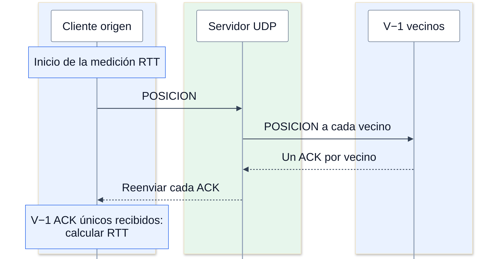
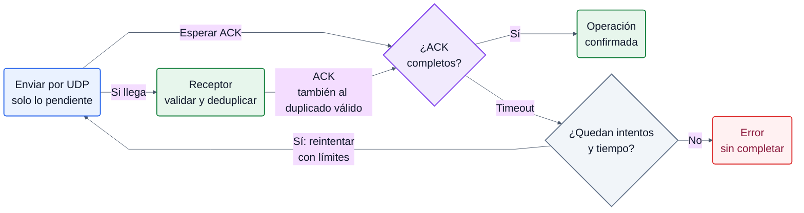
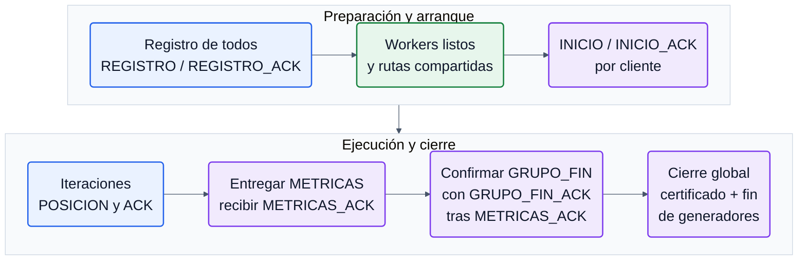

# Protocolo UDP definitivo

Implementación Python de `udp/`. El flujo académico se mantiene: REGISTRO → esperar N registros → INICIO → I ciclos POSICION/ACK → METRICAS → comprobación y cierre. El servidor es la autoridad de identidades y grupos. No hay TCP, ACK entre vecinos directos ni una barrera global entre iteraciones. [ARQUITECTURA](ARQUITECTURA.md) contiene ejecución y concurrencia; [CAMBIOS_UDP](CAMBIOS_UDP.md) recoge correcciones y pruebas.

## Datagramas e identidad

Cada datagrama contiene exactamente un objeto JSON UTF-8, versión1, máximo8192 bytes. No existe framing TCP ni cabecera binaria. Envelope real:

```json
{"version":1,"sesion":"run-001","tipo":"ACK","origen":2,"grupo":1,"datos":{"destino":1,"iteracion":3}}
```

`sesion` identifica la ejecución global. `instancia` es un identificador nuevo del proceso S, incluso si se reutilizase una sesión por error. Cada G tiene `generador`, nonce de control y SHA-256 del manifiesto. Cada cliente posee un token de registro estable; tras REGISTRO_ACK obtiene `cliente_id` y `grupo_id`. No puede considerar registrado un ID deducido localmente.

Los identificadores admiten 1..64 caracteres ASCII alfanuméricos, guion y guion bajo. Se rechazan mensajes truncados, JSON mal formado, versión/tipo desconocidos, tipos incorrectos —incluido bool donde se exige int— y números no finitos. La validación de estado añade sesión, endpoint registrado, grupo, destino, instancia y rango1..I. Un dato bien formado puede ser inválido en un estado determinado.

N, V e I son enteros positivos; N debe ser divisible por V. Grupo de ID c: `1 + (c−1)//V`. V incluye al propio cliente y hay V−1 vecinos. Con V=1 se envía la posición y se completa sin esperar vecinos inexistentes.

## Registro e inicio

| Mensaje | Datos significativos |
|---|---|
| GENERADOR_HOLA / ACK | generador, nonce, manifiesto, secuencia; solicitud N/V/I/Nlocal; respuesta instancia y endpoint observado |
| REGISTRO | token, generador, num_clientes=N global, num_vecinos=V, total_iteraciones=I; origen/grupo cero |
| REGISTRO_ACK | cliente_id, grupo_id, N/V/I, token e instancia |
| INICIO | destino, token e instancia |
| INICIO_ACK | origen/grupo registrados e instancia |

N local determina cuántos clientes crea un G; no cambia N global enviado al servidor. El manifiesto exige IDs G únicos, suma exacta de N locales y presupuestos locales que sumen el global. No impone afinidad de grupos por generador.

El registro se deduplica por `(generador, token)`, conservando el mismo endpoint. Repetir la solicitud no consume otro ID. Intentar cambiar el endpoint o registrar más clientes que el cupo se rechaza. Si INICIO adelanta a REGISTRO_ACK, C lo retiene y comprueba después la identidad, en vez de declararse iniciado sin registro confirmado.

Solo worker0 recibe al principio. Tras publicar las rutas inmutables, cualquier receptor puede contestar registros repetidos con la misma identidad. Una posición propia requiere el envío real de INICIO para ese origen; la transición multihilo no elimina esa comprobación.

## Comunicación de una iteración

| Mensaje | Datos |
|---|---|
| POSICION | iteracion, coords con tres números finitos; opcional pendientes con vecinos únicos del mismo grupo |
| ACK | destino = origen de la operación; iteracion de esa operación; origen = vecino que responde |



*El servidor reenvía POSICION a los V−1 vecinos y devuelve al origen el ACK de cada uno. El cliente mide el RTT desde el primer envío hasta el último ACK único necesario; los duplicados no cuentan.*

S valida y reenvía DATA directamente; no ejecuta las iteraciones del cliente ni almacena sus posiciones. C conserva una operación por iteración y un conjunto de vecinos que ya confirmaron. Un duplicado no incrementa progreso ni añade otra muestra RTT. Un ACK de k no satisface k+1; se reconoce un ACK tardío de una operación anterior sin confundir estados.

Las posiciones recibidas de vecinos se deduplican por `(origen, iteración)`. Un duplicado coherente vuelve a producir ACK para recuperar la respuesta perdida; coordenadas contradictorias se rechazan. Un cliente puede atender la posición válida de un vecino mientras espera su propio INICIO o mientras ya ha terminado sus iteraciones. Así un G rápido no deja huérfanos a sus vecinos lentos.

RTT de aplicación: reloj local desde el primer envío efectivo de POSICION hasta el último ACK único necesario. Incluye retransmisiones, servicio S, callbacks y planificación; excluye la espera inicial de admisión. Con V=1, el final se toma después del envío. Un timeout no crea una muestra exitosa. La media del cliente se calcula sobre sus I operaciones completas.

## Fiabilidad del protocolo UDP (ARQ)



*La fiabilidad la aporta ARQ sobre UDP; no se utiliza TCP. Ante timeout se reintenta con el backoff, jitter y limitadores existentes, y un duplicado válido se confirma sin repetir sus efectos. Agotar los intentos o el tiempo disponible produce un error y una ejecución incompleta.*

La misma implementación `_exchange` atiende registro, posiciones y métricas. Se conserva el control existente; no se añade otro mecanismo de fiabilidad ni un transporte alternativo.

1. Obtener los permisos compartidos y comprobar que la operación sigue pendiente.
2. Enviar; entonces empieza el RTO.
3. Esperar la confirmación de esa operación, atendiendo entretanto otros datagramas.
4. Al expirar, aplicar backoff, jitter y presupuesto de retries; retransmitir únicamente si sigue pendiente.
5. Fallar explícitamente al agotar intentos o el timeout administrativo/de fase.

Perfil: RTO inicial250 ms, techo2 s, máximo8 envíos incluido el inicial, jitter entre80–100 % del RTO. REQUEST incluye solicitudes iniciales y retransmisiones; RETRY es un subpresupuesto adicional que nunca puede saltarse REQUEST. Registro tiene además su presupuesto/ventana propios. Las posiciones ocupan un permiso de ventana hasta completar la operación. Si un ACK tardío llega esperando presupuesto, cancela el reenvío obsoleto.

En POSICION, cuando ya hay ACK de algunos vecinos, el retry incluye solamente los pendientes. Un reenvío sin backoff o que eluda el limitador puede multiplicar la congestión por V−1; no se usa. Los ACK reactivos se atienden sin esperar tokens de solicitudes.

INICIO y GRUPO_FIN tienen su propio scheduler de control en S, con los mismos intentos/backoff y pacing CONTROL. El control de cinco generadores usa solicitudes/respuestas correlacionadas por nonce, secuencia, sesión, instancia y manifiesto. ESTADO_RUN pendiente es una respuesta válida que permite consultar después; perder la respuesta sí activa su ARQ.

Los límites acotan espera y carga; UDP no puede garantizar entrega ante pérdidas permanentes o un receptor caído. La garantía es recuperación acotada o fallo explícito y diagnosticado, nunca progreso ficticio.

## Registro, métricas y finalización

METRICAS contiene `latencia_media_ms`, `total_iteraciones` y `acks_unicos`, con origen/grupo registrados. S exige exactamente I y `I×(V−1)` ACK únicos declarados, media finita/no negativa y una fase autorizada. Guarda una sola métrica por cliente: repetir la misma vuelve a recibir METRICAS_ACK; una repetición contradictoria se rechaza.

Los contadores de G acreditan sus operaciones/ACK efectivos. S valida el contenido y las barreras de control; no reconstruye un historial completo de todos los ACK DATA. El certificado de simulación y la validación del benchmark comprueban ambos extremos. El protocolo académico no pretende tolerar clientes maliciosos que inventen estadísticas.



*El servidor espera todos los registros y prepara los workers antes de enviar INICIO; cada cliente completa sus iteraciones y confirma sus métricas. **GRUPO_FIN no sustituye a METRICAS_ACK**: si llega antes, se retiene GRUPO_FIN_ACK hasta recibir la confirmación de métricas. Tras cerrar todos los grupos, los generadores validan el certificado y confirman su fin para completar el cierre global.*

METRICAS_ACK debe recibirse explícitamente. GRUPO_FIN ya no sustituye ese ACK. Si se adelanta, C difiere GRUPO_FIN_ACK; así S no cierra antes de recuperar las métricas confirmadas. Perder GRUPO_FIN o su ACK se recupera mediante el scheduler de S y la respuesta idempotente de C.

El certificado incluye sesión/instancia/N/V/I/SHA, éxito, N registrados/iniciados/métricas/cierres, NI iteraciones y N/V grupos completos. Cada G lo valida antes de cerrar sus clientes y enviar FIN. S no declara el resultado final exitoso hasta recibir FIN de todos los G. La retención terminal permite responder consultas/FIN retransmitidos; su duración no es una prueba de éxito por sí sola.

## Ejecuciones incompletas

No llegar a la primera métrica, perder una métrica permanentemente, fallar un cliente/G, agotar ARQ o vencer el deadline impide acreditar éxito. S exporta los IDs registrados cuyas métricas/inicio/cierre faltan y el número de clientes aún no registrados. G registra clientes sin METRICAS_ACK y errores. El controlador combina los JSON disponibles, ausencia de informes, exit codes, OOM y causa de cancelación/timeout.

`valid` y `valid_recovered` requieren todas las barreras. `incomplete`, `cancelled` y checkpoints `running/finalizing` no son referencias válidas de throughput. Recuperar una pérdida es admisible y se contabiliza; no se interpreta todo timeout como pérdida física demostrada. La escritura atómica y los límites administrativos se explican en ARQUITECTURA.
