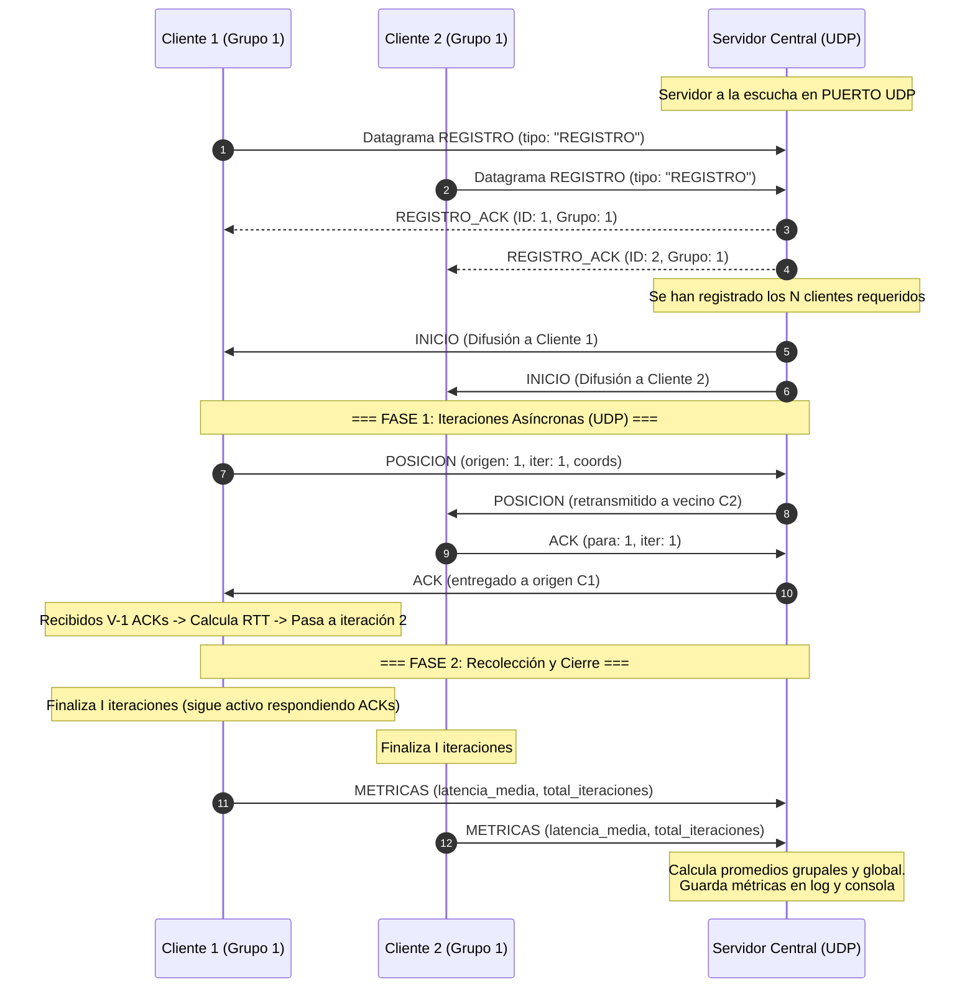
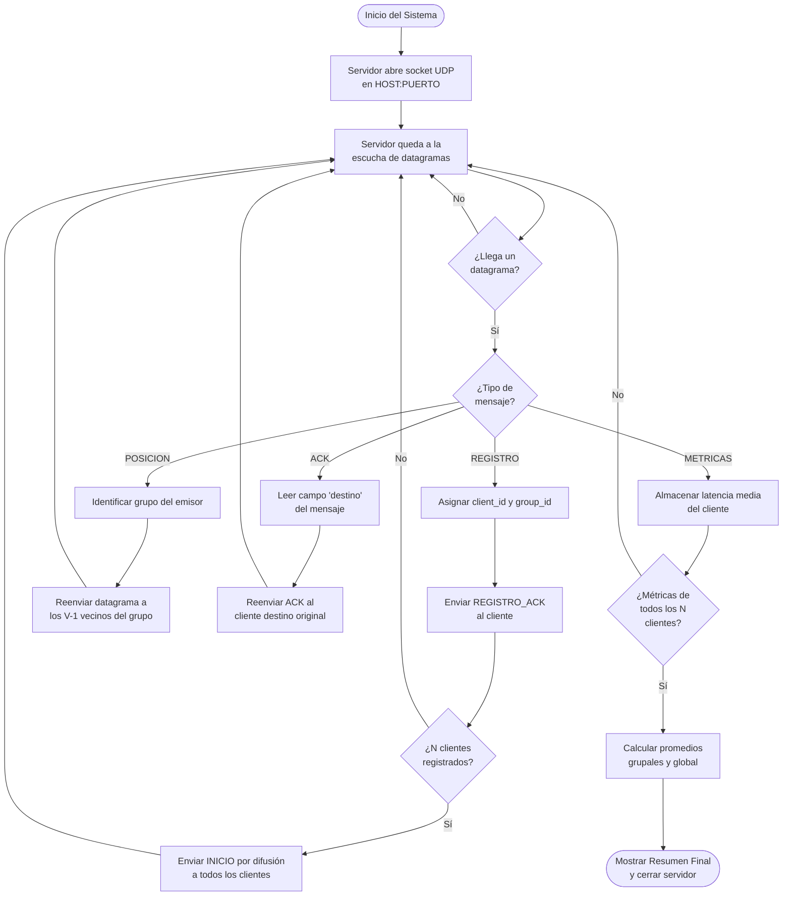
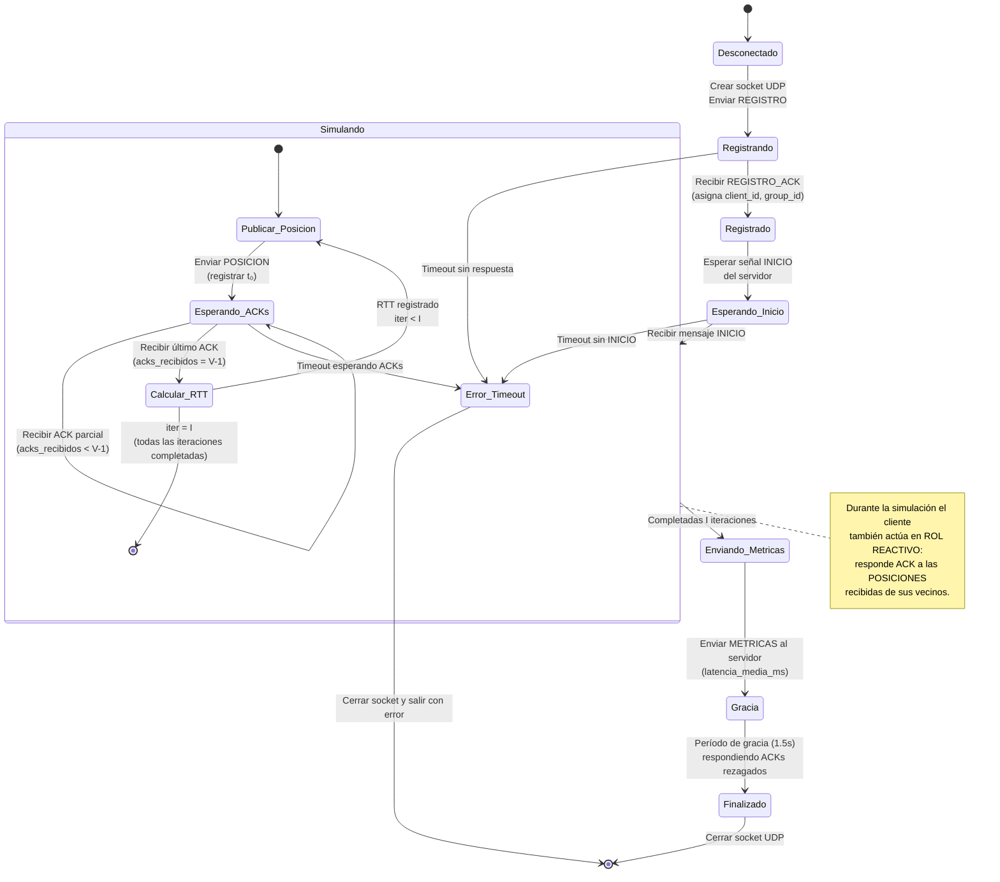
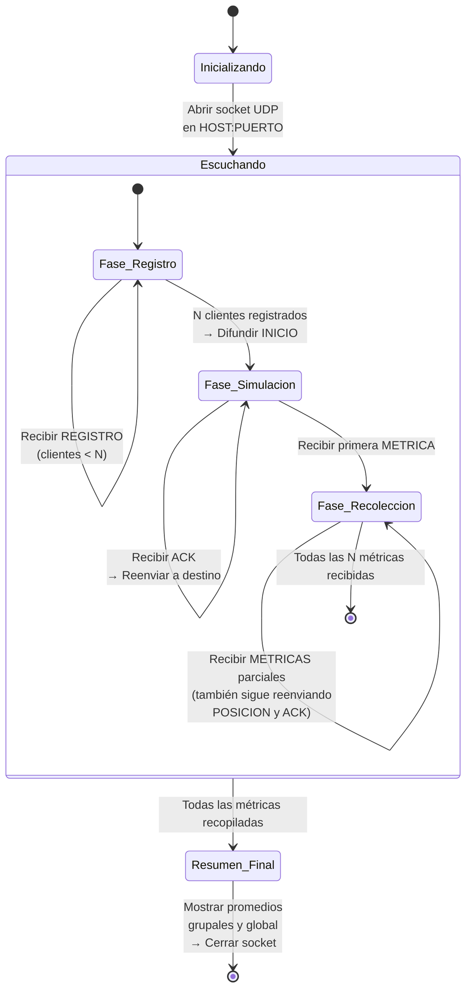
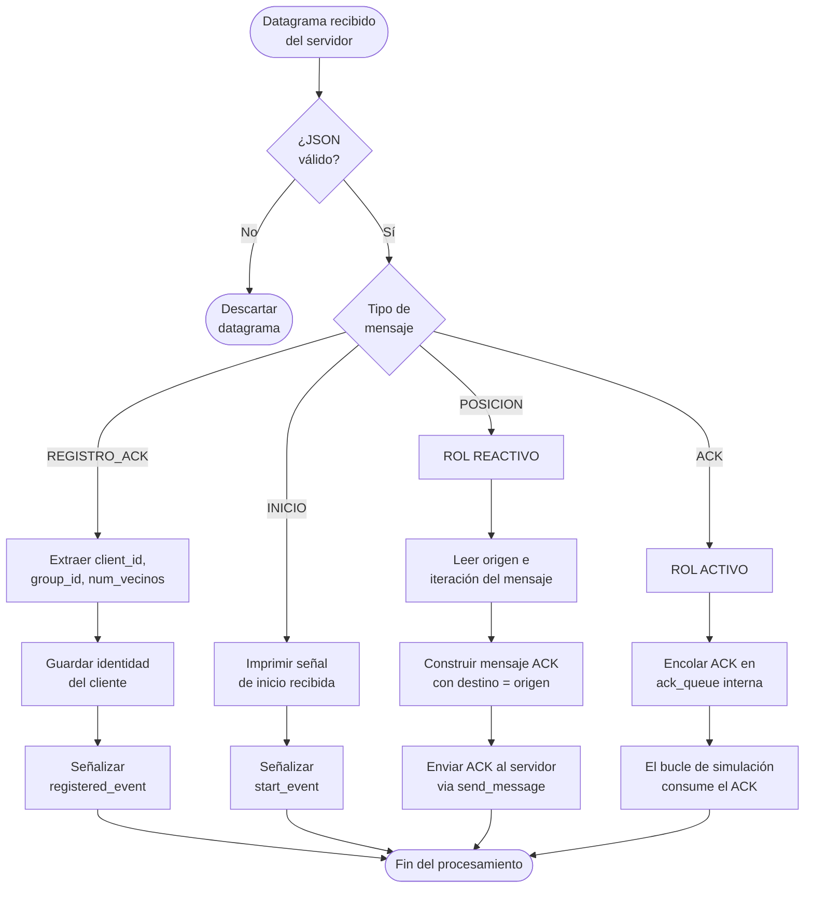
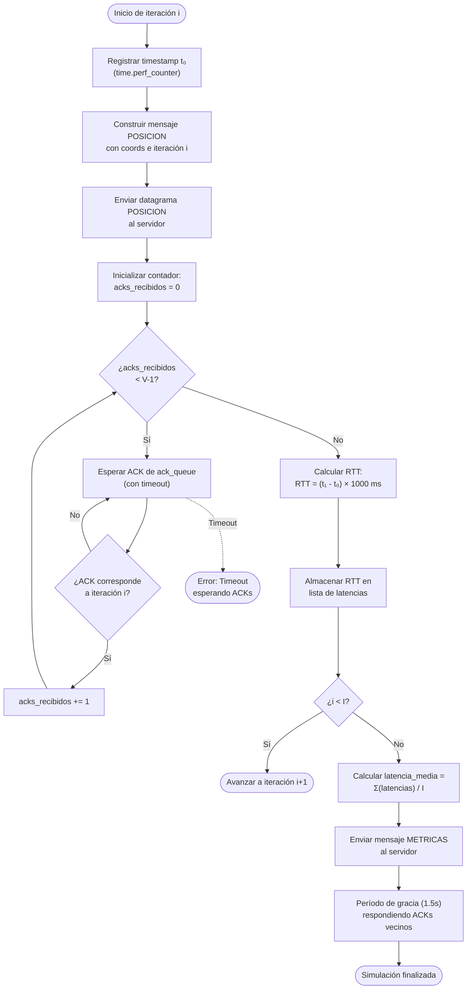

# 3. Protocolo de Aplicación (Versión UDP)

## 3.1 Estructura del Datagrama (Sin Framing)

A diferencia de la implementación sobre TCP, el protocolo **UDP es orientado a mensajes (*datagram-oriented*)** y preserva los límites de cada paquete en la capa de transporte. Por este motivo, **no requiere una cabecera explícita de encuadre (*framing*) ni prefijo de longitud** (`uint32`).

Cada datagrama transmitido contiene directamente el cuerpo del mensaje estructurado en formato **JSON codificado en UTF-8**:

```text
+-------------------------------------------------------------------+
|                     Cuerpo del Mensaje (JSON)                     |
|                  Payload del Datagrama UDP (UTF-8)                |
+-------------------------------------------------------------------+
```

---

## 3.2 Tipos de Mensajes y Esquemas

Todos los mensajes transmitidos en la simulación comparten la estructura básica en JSON con los campos comunes: `tipo` (identificador de mensaje), `origen` (ID del cliente emisor; `0` reservado para el servidor), `grupo` (identificador del grupo asignado) y campos de datos específicos.

| Tipo | Emisor | Destinatario | Descripción |
| :--- | :--- | :--- | :--- |
| **`REGISTRO`** | Cliente | Servidor | El cliente solicita asignación de identificador (`client_id`) y grupo (`group_id`) enviando un datagrama inicial al servidor. |
| **`REGISTRO_ACK`** | Servidor | Cliente | El servidor confirma la asignación devolviendo el `client_id` y `group_id` asignados. |
| **`INICIO`** | Servidor | Difusión (*Broadcast*) | Orden enviada por el servidor a todos los clientes registrados una vez completado el cupo de $N$ clientes. |
| **`POSICION`** | Cliente $x$ | Servidor $\rightarrow$ Vecinos | Notificación de coordenadas $(x, y, z)$ enviada al servidor, que la retransmite a los $V - 1$ vecinos de grupo. |
| **`ACK`** | Vecino | Servidor $\rightarrow$ Cliente $x$ | Confirmación de recepción de posición devuelta por el vecino hacia el servidor, que la redirige al emisor original. |
| **`METRICAS`** | Cliente | Servidor | Envío de la latencia media calculada por el cliente tras completar sus $I$ iteraciones. |

---

## 3.3 Ciclo de Vida Completo

El ciclo de vida del sistema comprende tres fases principales:
1. **Fase de Registro e Inicio:** Los clientes envían datagramas de `REGISTRO` sin necesidad de establecer conexiones persistentes. Una vez alcanzados los $N$ clientes requeridos, el servidor difunde el mensaje `INICIO`.
2. **Fase 1 (Iteraciones Asíncronas UDP):** Cada cliente envía de forma asíncrona sus coordenadas (`POSICION`), el servidor las enruta hacia los $V-1$ vecinos del grupo, y estos responden con un datagrama `ACK` redirigido al origen. Al reunir los $V-1$ ACKs, el cliente calcula el RTT de la iteración y avanza a la siguiente.
3. **Fase 2 (Recolección y Cierre):** Tras $I$ iteraciones, cada cliente envía su mensaje `METRICAS` y permanece activo respondiendo ACKs de sus vecinos. El servidor consolida las métricas grupales y globales al recibir la totalidad de los reportes.

### Diagrama de Secuencia



---

## 3.4 Diagrama de Flujo General del Sistema

El siguiente diagrama de flujo muestra la lógica completa de la simulación desde el arranque del servidor hasta la finalización del último cliente. Se aprecian las tres fases principales (Registro, Iteraciones y Métricas) y la interacción entre los roles de **servidor**, **cliente activo** (el que publica posición) y **cliente reactivo** (el que responde con ACK).



> **Lectura del diagrama:** El servidor opera como un *bucle de eventos* no bloqueante (reactor pattern). Cada datagrama recibido se clasifica por su campo `tipo` y se procesa de forma síncrona. El diagrama refleja fielmente la función [`handle_datagram()`](file:///Users/hectorpons/proyectos/arq_redes_comp/udp/server.py#L72-L152) del servidor.

---

## 3.5 Diagrama de Estados del Cliente

Cada cliente recorre un ciclo de vida bien definido con estados claramente diferenciados. El diagrama de estados inferior modela las transiciones del autómata finito del cliente, incluyendo los flujos de error por timeout.



> **Nota sobre el rol dual:** Mientras un cliente está en el estado `Simulando`, opera simultáneamente en dos roles. Como **emisor activo** envía su posición y espera ACKs; como **receptor reactivo** responde con ACK a las posiciones que recibe de vecinos. Esto se implementa mediante el método [`handle_datagram()`](file:///Users/hectorpons/proyectos/arq_redes_comp/udp/client.py#L74-L115) que procesa datagramas de forma concurrente al bucle de iteraciones.

---

## 3.6 Diagrama de Estados del Servidor

El servidor UDP sigue un modelo de estados más simple, ya que actúa como un *router de mensajes* sin estado de sesión complejo (al contrario que TCP, no mantiene conexiones persistentes).



> **Observación clave:** A diferencia de un servidor TCP, aquí **no existe estado de conexión por cliente**. El servidor identifica a cada cliente únicamente por su dirección `(IP, puerto)` del datagrama recibido, almacenada en el diccionario [`addr_to_id`](file:///Users/hectorpons/proyectos/arq_redes_comp/udp/server.py#L63). Esto simplifica el modelo de estados pero exige manejar posibles datagramas duplicados de registro.

---

## 3.7 Diagrama de Flujo: Procesamiento de Datagramas en el Cliente

Este diagrama detalla la lógica interna del cliente al recibir un datagrama del servidor, mostrando cómo se bifurca el procesamiento según el tipo de mensaje y los dos roles (activo/reactivo).



> **Detalle de implementación:** El cliente utiliza una cola asíncrona [`ack_queue`](file:///Users/hectorpons/proyectos/arq_redes_comp/udp/client.py#L68) para desacoplar la recepción de ACKs (callback no bloqueante en `handle_datagram`) del consumo secuencial en el bucle de iteraciones. Los mensajes de tipo `POSICION` se responden de forma inmediata sin pasar por la cola, garantizando baja latencia en el rol reactivo.

---

## 3.8 Diagrama de Flujo: Iteración de Simulación del Cliente

Este diagrama muestra en detalle lo que ocurre dentro de **cada iteración** del bucle principal del cliente activo, desde la publicación de la posición hasta el cálculo del RTT.



> **¿Por qué se filtran ACKs por iteración?** Un ACK puede llegar desordenado o pertenecer a una iteración anterior. La condición `ack.datos.iteracion == i` (línea del [bucle de simulación](file:///Users/hectorpons/proyectos/arq_redes_comp/udp/client.py#L162-L165)) garantiza que sólo se contabilizan los ACKs correspondientes a la iteración actual, descartando los obsoletos.
